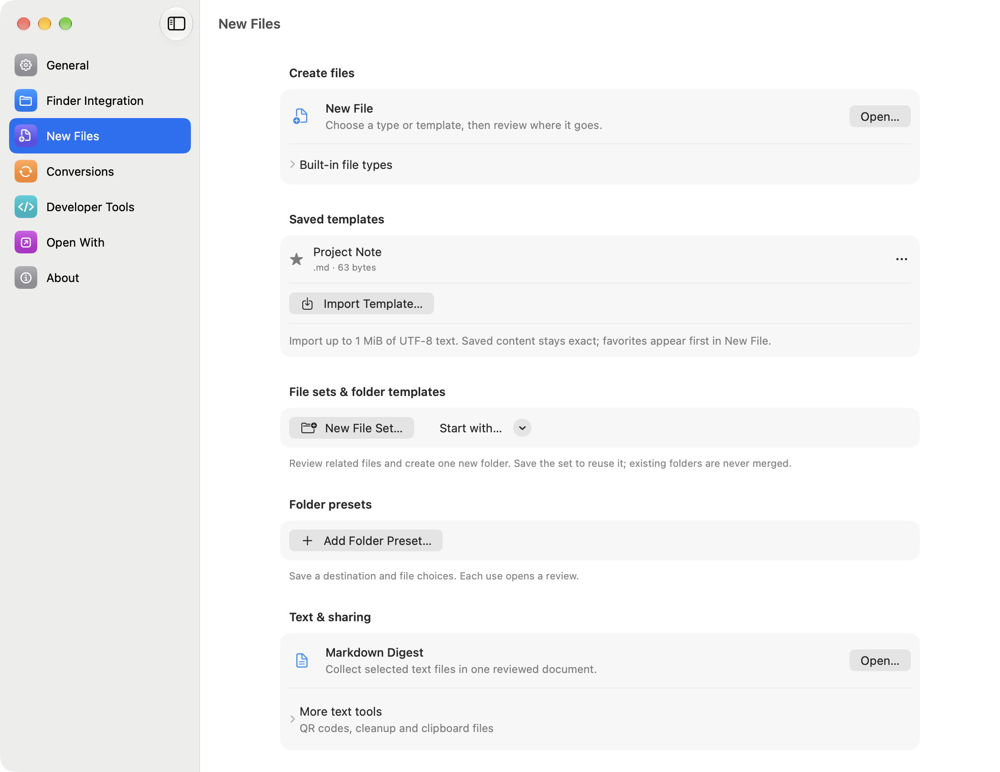

# CloakTools

**Small tasks. Less friction.**

[Website](https://tools.cloakyard.com/) · [Source](https://github.com/cloakyard/cloaktools) · [Support](https://ko-fi.com/sumitsahoo21)

<p align="center">
  <a href="LICENSE"></a>
  
  
  
  
</p>

<p align="center">
  <picture>
    <source media="(prefers-color-scheme: dark)" srcset="assets/screenshots/new-files-dark.png">
    
  </picture>
</p>

## Overview

A native macOS toolkit for creating files, preparing copies and opening links in the right app. Everyday tools are included; Developer Tools is an optional first-run choice. The SwiftUI app is separate from its Air website. The capture above shows the actual development app with no personal files.

The source is **0.6.0, build 20261118.1**, a local development preview. The website is live at tools.cloakyard.com; a public installer is still pending. See [release instructions](docs/RELEASE.md) for the signing boundary and [the usage guide](docs/USAGE.md) for every implemented workflow.

## Features

| Capability | Implementation |
|---|---|
| **Create files** | Text, Markdown, PDF, exact-content saved templates, favorites, folder presets and reviewed nested file sets. Existing files receive numbered copies. |
| **Choose your tools** | Everyday tools are always included. Optional Developer Tools adds JSON and 13 programming languages, including Rust, C and C++, plus Hello World starters. Preferences survive hiding the group. |
| **Work with developer data** | Local JSON validation/formatting, Base64 text and image encoding/decoding, synthetic sample files and reviewed JSON/environment placeholder copies. |
| **Prepare images** | Convert PNG/JPEG/TIFF/HEIC input; Make It Fit measures an output against byte and dimension limits before saving the exact preview. |
| **Reuse exports** | Saved image, size-budget and media recipes; full-clip MP4 or M4A export with native preview and cancellation. |
| **Organize PDFs** | Assemble PDFs/images; select, reorder and rotate pages, then export an ordinary PDF without modifying its sources. |
| **Handle text and sharing** | Clipboard to file, QR creation/reading, text cleanup, Markdown digests, reviewed CSV/Markdown file lists and Copy As formats. |
| **Route links** | Separate web/email defaults with guarded restoration, ordered rules, pinned destinations, per-role fallback, an offline tester and explicit one-time bypass. |
| **Work from Finder** | Workspace-scoped Finder menus, selected-item Services and compact native operation dialogs. |

### Current boundaries

Shortcuts actions and additional Finder-folder configuration are implemented, but execution needs a matching team signing identity and further live verification. Signing and notarization are deferred. Verified Edge/profile routing, spoken VoiceOver, macOS 27.0 runtime acceptance and broader installer/filesystem/codec coverage remain open. See the [roadmap](docs/ROADMAP.md) and [latest native verification](docs/verification/ROADMAP-IMPLEMENTATION.md).

Standalone OCR, basic batch renaming, ZIP tools, Keep Awake and generic inspection are outside the active roadmap because macOS already supplies those workflows. Existing overlapping tools remain available in compact secondary groups; see the [macOS feature audit](docs/MACOS-FEATURE-AUDIT.md).

### Troubleshooting

If a Finder menu is missing, enable **CloakTools Finder** in System Settings and use the bounded CloakTools Files workspace. Selected-item Services cover other accessible folders. See [Finder access](docs/FINDER-ACCESS.md).

If a destination app or default change is unavailable, use **Open With → Refresh Status** and review the actual state. Restore preferred web/email handlers before uninstalling. Setup and restoration do not create routing rules. See [Open With](docs/OPEN-WITH.md).

## Privacy

No accounts, analytics, cloud processing, link prefetch or browsing-history persistence. Processing and settings stay local. Sparkle update checks/downloads are manual unless you enable them in About. See [update publishing](docs/UPDATES.md). Cloud-managed folders and chosen destination apps follow their own policies. Files are published as new copies, with explicit review and bounded inputs. Read [Privacy](PRIVACY.md) and [Security](SECURITY.md) for exact storage and reporting boundaries.

## Getting started

Requires **macOS 27 or later on Apple silicon**, Xcode 27 and [XcodeGen](https://github.com/yonaskolb/XcodeGen). Intel Macs are not supported. There is no public installer yet.

```sh
brew install xcodegen
git clone https://github.com/cloakyard/cloaktools.git
cd cloaktools
./scripts/build-native.sh
open apps/macos/build/Verify/Build/Products/Debug/CloakTools.app
```

On first launch, leave **Developer Tools** off for the everyday catalog or enable it for technical tools. Choose **Start Using CloakTools**. You can change the choice in **General → Your tools**. General has quick actions; New Files, Conversions and Open With organize the remaining workflows. **⌘,** reopens Settings and **⌘N** creates a file.

Builds are locally ad-hoc signed and not notarized. Current recorded runtime checks used macOS 27.2.1; macOS 27.0 has not been exercised. Full tool instructions and shortcuts are in [the usage guide](docs/USAGE.md).

## Development

### Native app

`apps/macos/project.yml` is authoritative; XcodeGen creates the ignored Xcode project. The build is arm64-only, has no hardcoded Team ID and uses local ad-hoc signing. Development uses Xcode 27, Swift 6 and macOS system frameworks, with Sparkle 2 as an app-only dependency; the headless core has no third-party dependencies.

| Layer | Choice |
|---|---|
| App | SwiftUI, AppKit, FinderSync and native Liquid Glass controls |
| Core | Swift models, bounded operations, immutable review snapshots and safe file publication |
| Media | Core Image, ImageIO, Vision, PDFKit, AVFoundation and AVKit |
| Automation | App Intents with signed-runtime verification still required |
| Build | XcodeGen; independent Astro website with pinned npm dependencies |

### Verification

```sh
./scripts/build-native.sh
(cd apps/macos/Packages/CloakToolsCore && GIT_CONFIG_COUNT=0 swift test)
(cd apps/site && npm ci && npm run verify)
node scripts/check-readmes.mjs
node scripts/check-air-design.mjs
node scripts/check-air-portability.mjs
```

The **November 16, 2026** native audit passed **224 core tests and 8 hosted app tests**. This is dated evidence, not a claim that browser checks revalidate native behavior. See [the native audit](docs/verification/ROADMAP-IMPLEMENTATION.md) for exact coverage and remaining gates. Website verification is recorded separately in [the Air audit](docs/air/AUDIT-2026-11-17.md).

### Website

The static website lives in [`apps/site`](apps/site/README.md), with its own install/build/browser checks. It works from a standalone checkout and has no sibling-repository runtime dependency.

## Design and assets

The website follows the complete portable [Air contract and product appendix](apps/site/DESIGN.md), with a pinned local Air 1.7.5 bundle. [Native design](NATIVE_DESIGN.md) preserves SwiftUI, SF Symbols and macOS conventions.

[Asset documentation](assets/README.md) owns the editable Icon Composer source, circular web mark, actual light/dark app captures and shared Air social card. The unique finite animation fans three documents into a tool tray, with a static fallback and deliberate replay. Social metadata uses the same 1200 × 630 card recipe as CloakDrop and CloakRoll.

## Project structure

In `apps/macos/App/`, `App/` holds the entry point and app state, `Features/` groups product workflows, `Shared/` holds reusable UI helpers and `Resources/` contains app resources. Headless code and its tests live under `apps/macos/Packages/`.

```text
cloaktools/
├── apps/macos/                 # Native app, Finder extension, core and tests
├── apps/site/                  # Independent static Air website
├── artwork/social.json         # Product copy and artwork for the shared OG card
├── assets/                     # Icon sources, social image and app captures
├── scripts/                    # Build, asset sync and verification helpers
└── docs/                       # Usage, architecture, roadmap and audit evidence
```

See [architecture](ARCHITECTURE.md), [supported formats](docs/FORMATS.md) and [the roadmap](docs/ROADMAP.md).

## Deployment and releases

The app uses a three-part marketing version and an increasing `YYYYMMDD.N` build number.
See the [Mac release guide](docs/MAC-RELEASE.md) for the Air installer, version settings and Developer ID workflow.

Maintain only `dev` and `main`. Work on `dev`, verify, then promote the same reviewed changes to `main`. Keep `dev` synchronized with the published revision after each release; pushes and deployment are explicit maintainer actions.

The website is hosted on Cloudflare Workers at tools.cloakyard.com. `apps/site/wrangler.jsonc` pins the existing custom domain, static output and HTTP 404 handling. Workers Builds uses `main`, root `apps/site`, build command `npm ci && npm run verify` and deploy command `npx wrangler deploy`. Verified changes promoted from `dev` to `main` publish automatically. `npm run check:worker` in `apps/site` validates the deployment bundle without publishing.

Nonproduction branch builds use `npx wrangler preview` with the checked-in `previews` configuration. Cloudflare publishes the same static site to a branch Preview; only `main` updates tools.cloakyard.com. Production version URLs and workers.dev remain disabled.

Native releases are separate. `python3 scripts/release.py --preview` creates a verified local ZIP; Developer ID signing and notarization remain deferred. See [Release](docs/RELEASE.md). Keep release binaries and generated build output out of source control. Users can check for updates in About or enable automatic checks there.

## Contributing

Read [Contributing](CONTRIBUTING.md), [native design](NATIVE_DESIGN.md) and the [website design contract](apps/site/DESIGN.md). Preserve user files, keep changes bounded and record actual verification. Compare all applicable website views across phone, tablet, laptop and desktop layouts in both themes. The About pane’s **Buy me a coffee** link uses the same [Ko-fi destination](https://ko-fi.com/sumitsahoo21) as the family websites and GitHub Sponsor button. Use [GitHub issues](https://github.com/cloakyard/cloaktools/issues) for reproducible bugs without private data.

The [family README standard](https://github.com/cloakyard/cloakyard/blob/main/docs/README_STANDARD.md) defines this section order. Support development through [Buy me a coffee](https://ko-fi.com/sumitsahoo21). Commit messages must not include co-author trailers.

## License

Released under the [MIT License](LICENSE). Air retains its pinned upstream provenance in [the bundle manifest](docs/air/bundle.json); third-party tooling retains its own licenses.

Built by [Sumit Sahoo](https://github.com/sumitsahoo), part of [Cloakyard](https://cloakyard.com/).
