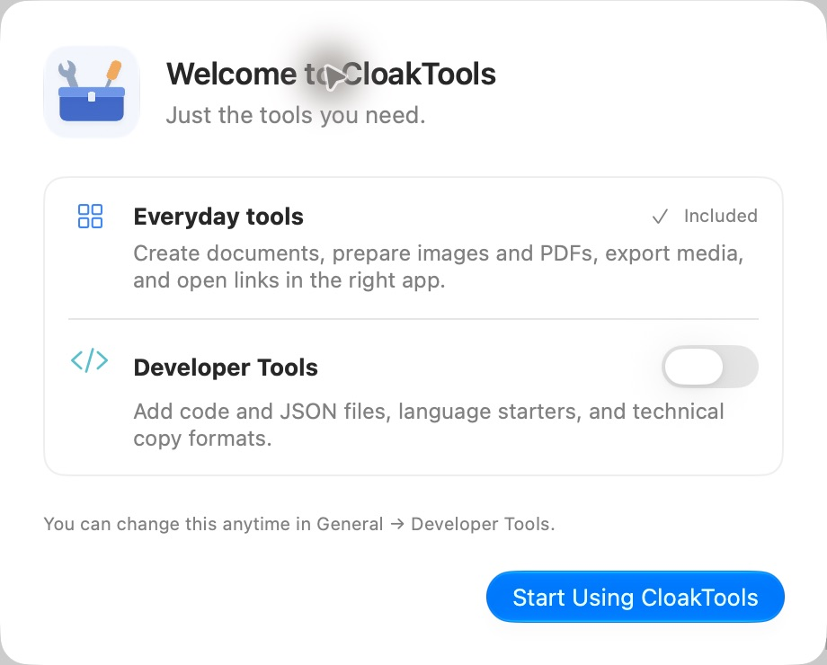

# CloakTools usage guide

This guide follows the development Workbench. The published 0.6.0 beta uses the earlier settings sidebar. Commands run from the repository root unless stated otherwise. For an overview, build status and contribution guidance, see the [project README](../README.md).

**Small tasks. Less friction.** A native macOS toolkit in the Cloakyard family.

Canonical website: [tools.cloakyard.com](https://tools.cloakyard.com). The [source repository](https://github.com/cloakyard/cloaktools) is available; the [public beta](https://github.com/cloakyard/cloaktools/releases/tag/v0.6.0-beta.20261118.2) includes the installer and checksums.



Compact native dialogs use Liquid Glass actions. [New file](../assets/screenshots/new-file-light.png) · [Dark chooser](../assets/screenshots/link-chooser-dark.png) · [Earlier dark settings](../assets/screenshots/settings-m1-dark.png).

## Status and features

The **0.6.0 beta** adds three buildable Shortcuts actions, signed-build Finder-folder configuration, conservative incoming-event source recognition, private output staging and abandoned media-capture recovery. Shortcuts execution and additional Finder folders remain unavailable in this ad-hoc preview; signing is deferred by the project owner. A verified local ZIP and an explicit Developer ID/notarization pipeline are included. See [implementation and audit evidence](verification/ROADMAP-IMPLEMENTATION.md) and [release instructions](RELEASE.md).

Earlier working features include [media export](verification/MEDIA-EXPORT.md), [PDF page organization](verification/PDF-PAGES.md), [Make It Fit](verification/MAKE-IT-FIT.md), [destination preferences](verification/DESTINATIONS.md), [default-handler setup/restoration](verification/DEFAULT-HANDLERS.md), [routing rules/testing](verification/ROUTING-RULES.md), [PDF/Copy As](verification/PDF-COPY-AS.md), [image conversion](verification/IMAGE-CONVERSION.md), [clipboard](verification/CLIPBOARD.md) and [historical integration records](verification/MILESTONE-1.md).

| Available in this checkout | Scope |
| --- | --- |
| Default link apps | Separate web/email setup, current status, saved prior apps and guarded restoration |
| Link rules | Ordered web/email rules, All/Any conditions, explicit app destinations, offline tester and one-time bypass |
| Destinations | Pin and reorder compatible apps, see availability, and choose independent web/email fallback apps or the chooser |
| JSON & Base64 | Optional local text tools, precise JSON numbers, line/column errors, standard/URL-safe text, image/data-URL previews, explicit copying and safe image saving |
| Sample Files | Synthetic JSON/CSV records and exact-size text/binary files, bounded previews, explicit copying/saving and numbered collisions |
| Example Copy | JSON/environment placeholders, source/example comparison, preserved keys/structure and explicit safe saving |
| Your tools | First-run choice, everyday tools always included, optional Developer Tools, retained preferences and existing-install migration |
| Workbench and Settings | Search tools by task in the main window. Open separate tabbed preferences with ⌘,. |
| New files | Text, Markdown and one-page PDF; Developer Tools adds JSON and 13 programming languages with optional Hello World starters |
| Folder presets | Save a destination, file type/template, filename and blank-code preference; review through Files & Templates or the File menu before creating |
| QR Code | Create PNG codes or read selected images; numbered code selection, reviewed text and safe saving |
| File List | Selected files/folders, optional metadata columns, ordered CSV/Markdown previews and safe exports |
| Text Cleanup | Everyday whitespace tools, preserved input, reviewed changes and full-result copying/saving |
| Markdown Digest | Selected UTF-8 files, ordered source/digest review, literal fenced content and safe Markdown copies |
| File sets | Editable nested files and folders, reusable structures, separate review, whole-folder publication and numbered collisions |
| Saved templates | Import UTF-8 files, preserve exact content, edit titles/default names, favorite templates, and optionally open new files in TextEdit or Preview |
| Clipboard to file | One-time text/image capture, compact preview, UTF-8 text or PNG output, and safe names |
| Finder entry points | Blank-space and selected-item Finder Sync menus in a bounded workspace; selected-item Services |
| Image conversion | Single-frame PNG/JPEG/TIFF/HEIC → PNG, JPEG or HEIC; quality, backgrounds, saved defaults |
| Make It Fit | Preview PNG/JPEG/HEIC against maximum bytes and dimensions, then save the exact measured copy |
| Export recipes | Save image, fit or media settings; choose a fresh source and review each export; rename, update or save independent copies |
| Media export | Full-clip MP4/H.264 up to 720p or 1080p and AAC/M4A audio, checked per source, with native preview and cancellable export |
| PDF pages | Include individual pages or ranges, reorder, rotate, preview and export an ordinary PDF without altering its source |
| PDF assembly | Combine PDFs/images, reorder or remove sources, choose a destination, preserve existing files |
| Copy As | Preview and copy names, paths, file URLs, shell arguments, Markdown links or JSON |
| Link chooser | Real HTTP/HTTPS/mailto events, installed-app discovery, explicit Open Once, Copy Link, Cancel |
| Companion site | Home, Install, Privacy, Support, Source, 404, and local license page; Air 1.7.5 |

The [macOS feature audit](MACOS-FEATURE-AUDIT.md) narrows future work: standalone OCR, basic batch renaming, ZIP tools, Keep Awake and generic inspection are not planned. Existing tools that overlap with macOS enter maintenance/consolidation. Development prioritizes constrained image fitting, reviewed file sets/exports and cross-app routing, with Shortcuts integration. Verified Edge/profile routing and configurable Finder scopes still have documented prerequisites. See the release notes for the features and signing limits of the first public beta.

## Requirements

Apple silicon, macOS **27.0 or later**. Built and exercised on macOS 27.2.1 (26B131), Xcode 27.2 (27B52), macOS 27.2 SDK, Swift 6.4.2. Intel and older macOS versions are not supported. macOS 27.0 specifically has not been runtime-tested.

## Build, install, and first run

Install Xcode 27 and XcodeGen (`brew install xcodegen`), then from this repository:

```sh
./scripts/build-native.sh
open apps/macos/build/Verify/Build/Products/Debug/CloakTools.app
```

The authoritative project is `apps/macos/project.yml`; XcodeGen creates the ignored Xcode project. The build is arm64 and ad-hoc signed (`CODE_SIGN_IDENTITY=-`), with **no hardcoded Team ID**. Release retains hardened runtime and permits the embedded Sparkle framework through a library-validation exception. `python3 scripts/release.py --preview` builds a verified local ZIP. Developer ID signing and notarization are configured but deferred; the current public beta is ad-hoc signed. About contains Check for Updates and optional automatic checks/downloads, both off by default. Privacy explains local storage and update traffic. See [release instructions](RELEASE.md) and [signed updates](UPDATES.md).

The Dock opens the Workbench. **CloakTools → Settings… (⌘,)** opens a separate window. **⌘N** creates a file; **⌥⌘N** saves copied text/image content; **⇧⌘K** chooses an image to convert; **⌥⌘K** opens Make It Fit; **⇧⌘P** assembles a PDF; **⌥⌘P** organizes PDF pages; **⌥⌘E** exports media; **⌥⌘C** opens Copy As; **⌥⌘T** tests a link without opening it; **⌥⌘O** opens a link once with rules and fallback bypassed. Native lists, toggles, pickers, Return, Escape, and standard focus behavior support keyboard use. Progress and cancellation stay with the active conversion.

## Choose your tools

On a fresh installation, the welcome sheet includes **Everyday tools** and an optional **Developer Tools** switch, initially Off. Choose **Start Using CloakTools** to save the choice. It appears once, not on every launch. You can change the switch anytime in **Settings → General → Your tools**.

Everyday mode includes document creation, QR creation/reading, File List, Text Cleanup, Markdown digests, clipboard files, images, PDF/media tools, export recipes and link routing. New File offers plain text, Markdown and PDF. Enabling Developer Tools adds all 13 programming languages and JSON, source-file examples, and Shell arguments/JSON path list in Copy As. A **Developer Tools** sidebar section holds JSON, Base64, Sample Files and Example Copy alongside Hello World and per-language preferences. The switch adds these options without disabling everyday tools.

Turning it off hides technical saved templates and workflows by their referenced type or extension, without deleting them, their favorites or language choices. Existing operation drafts keep their captured choices; new operations use the current mode. Custom-template classification uses extension metadata only, never content inspection. Missing template references remain visible for repair. A direct request for a hidden programming type explains how to enable it instead of silently creating another type.

Existing preferences from older versions migrate with Developer Tools On and onboarding complete, preserving the previous catalog. This is a presentation preference, not a security boundary, account type or permissions grant. JSON validation/formatting and Base64 encoding/decoding are available in the Developer Tools sidebar and File → Developer Tools.

## Find your tools

Choose **Finder Tools**, **Files & Templates**, **Images, PDFs & Media**, **Text & Sharing**, **Open Links**, or the optional **Developer Tools**. Each page groups related actions and describes what each tool produces. Press **⌘F** to reveal the search field and search across visible categories. “PDF” lists PDF assembly and page organization first. “Merge PDF” narrows it to assembly, which you can open with **⌘Return**. When several results match, choose the one you want.

Select an action to open its editor. A Finder selection enters the review with its files already supplied. **Back (⌘[)** returns to the category or search results you came from. Choose **Resume** in the results or select the draft under **In Progress** to continue editing. Cancel, Close or Done releases that draft. A second incoming request for the same tool can open an independent review window.

Open **Settings** from the sidebar or with **⌘,**. General holds the tool choice and file-opening preferences. Finder holds workspace and extension setup, Images holds conversion defaults, and Links holds rules and destinations. Language starters live in the optional Developer tab. Privacy and About have their own tabs. For tested entry points and outputs, see the [Workbench verification](verification/WORKBENCH.md).

## JSON and Base64

Open **Developer Tools → Format or check JSON** or **Encode or decode Base64**, or use **File → Developer Tools**. Processing starts with the action button or **⌘Return**. Return alone edits text. Results are cleared when input/options change; closing a tool discards its session.

**JSON** offers Format, Minify and Validate with line/column errors. Two-space formatting preserves number precision/spelling, key order, duplicates and string escapes. Top-level values are supported; comments, trailing commas and malformed Unicode escapes are rejected. Input is capped at 1 MiB, nesting at 128 levels and formatted output at 8 MiB.

**Base64 → Text** encodes or decodes UTF-8 using Standard or URL-safe alphabets. URL-safe output omits padding; decoding accepts ASCII whitespace and missing padding. Input is capped at 1 MiB. Non-UTF-8 output directs you to Image mode for images; arbitrary binary files are not supported.

**Base64 → Image → Encode** lets you choose a PNG, JPEG, GIF, WebP, TIFF or HEIC/HEIF file. Review its preview and dimensions, choose whether to **Include data URL**, then Encode and Copy Result. Data URLs use the detected MIME type, such as `data:image/png;base64,…`. Turning the prefix off gives plain standard Base64.

**Image → Decode** accepts a standard Base64 payload or image data URL. Decode previews the image before any file is written. Enter a filename and choose **Save Image…**, then a destination folder. Original bytes, metadata, transparency and animation are preserved. Existing filenames receive a numbered copy. The preview shows the first frame; source files are never overwritten.

Image mode accepts files/decoded images up to 10 MiB, 40 megapixels per frame and 512 frames; pasted Base64 is limited to 14 MiB. Mismatched MIME prefixes, unsupported formats (including SVG), malformed Base64 and non-images are rejected. Results show up to 65,536 characters; copying includes the complete result. All processing stays local, without automatic clipboard reads or text history. See [image verification](verification/BASE64-IMAGES.md) and [JSON/text verification](verification/DEVELOPER-TEXT.md).

## Sample files

Open **Developer Tools → Generate sample files** or **File → Developer Tools → Sample Files…**. Choose JSON, CSV, Text or Binary, then a record count or file size. **Generate** (⌘Return) shows a preview and exact byte count without writing a file. Enter a name and choose **Save File…**, then a folder. Existing names receive a numbered copy. Success offers Show in Finder and Done.

JSON and CSV contain 1–10,000 deterministic records: an ID, synthetic name, `example.com` email, boolean and note. Notes cycle through plain text, commas, quotes, multiline text and Unicode. CSV uses UTF-8, a header, quoted fields and CRLF record endings. Text repeats ASCII content to the exact byte count; Binary creates zero-filled `.bin` data. Size accepts whole numbers from 1 byte through 32 MiB, with Bytes/KiB/MiB units (1 KiB = 1,024 bytes). The last text line may be partial. Binary files are useful for size checks, not representative compression tests.

Text previews show at most 8,192 bytes without splitting a UTF-8 character; binary previews show the first 64 bytes in hexadecimal. **Copy Text** includes all JSON/CSV/text content, even beyond the preview. Editing format/count/size clears the old result. Generation is local and reproducible, reads no source files or personal data, and keeps no history. Sample Files is separate from blank-file creation and Hello World preferences. See [verification and limits](verification/SAMPLE-FILES.md).

## Example copies of configuration

Open **Developer Tools → Create a configuration example** or **File → Developer Tools → Example Copy…**. Choose one JSON or environment file. Hidden `.env` files are shown in the picker. CloakTools captures up to 1 MiB of UTF-8 and prepares an example without changing the source or writing output. Compare the read-only **Example** and **Source** views, choose a filename, then **Save Example…** and a folder. Copy Example always copies the complete example, even while Source is selected. A successful copy/save returns the preview to Example.

JSON retains keys, key order, duplicate keys and object/array structure. String values become `"REPLACE_ME"`, numbers become `0`, booleans become `false`, and null stays null. The same strict parser used by JSON tools validates the source before replacement, with 128-level depth and 8 MiB output limits.

Environment files named `.env`, `.env.*` or `*.env` accept single-line `NAME=value` assignments and optional `export`. Every value becomes `REPLACE_ME`; comments and blank lines are removed, duplicate variable names and order are retained, and output uses LF endings. Quoted single-line values are supported; multiline values, mixed unquoted/quoted syntax, continuations and shell scripts are rejected with a line number. Nothing is evaluated. The default output is a visible `Environment example.env`; hidden output names are not supported in this slice.

Keys, variable names and structure remain in the example and may themselves contain private information. Review them before sharing; this tool does not detect secrets or guarantee anonymization. Preview text is limited to 65,536 characters per view; Copy/Save includes the entire example. Existing files receive numbered copies, including if you choose the source's filename. No input, output or history is retained after the window closes. See [verification and boundaries](verification/EXAMPLE-COPY.md).

## Create QR codes

Open **Text & Sharing → Create a QR code**. Choose what someone will scan from **Content**.

| Content | What to enter |
| --- | --- |
| Text or Web link | Paste a message exactly as you want it to appear, or enter a full HTTP or HTTPS address. |
| Contact card (vCard) | Enter a first or last name. Add a phone number, email, organization or website as needed. |
| Wi-Fi network | Enter the exact network name and choose WPA/WPA2 Personal, WEP or Open. For a protected network, enter its password. Select **Hidden network** if applicable. |
| Email, Phone call or Text message | Enter one email address or a phone number with its country code. Email supports a subject and message. Text message supports a prefilled message. |
| Map location | Enter latitude and longitude in decimal degrees. |
| Calendar event | Give the event a title, choose local start and end times, and optionally add a location. |

Choose **Create QR Code** (⌘Return) to preview the image. **Copy Image** puts the PNG on the clipboard. **Save PNG…** writes the reviewed image into the folder you choose, adding a number if the name is taken. Switch types to work on another code and return to your entries while the window stays open.

**Image settings** defaults to 512 pixels and Standard correction. Choose 1024 or 2048 pixels for denser codes, or High correction for greater damage tolerance. The 1,024-byte limit includes the encoded contact, network or event fields. Anyone with a Wi-Fi QR code can read its encoded password.

## Read QR codes

Open **Text & Sharing → Read a QR code from an image**, or switch to **Read** in the QR window. In Finder, **Services → Read QR Code from Image with CloakTools** starts with the selected image. Choose a still image. If it contains multiple codes, click a numbered outline or choose its number above the preview. The reader identifies the selected content. For Wi-Fi, choose **Show encoded text** to reveal the network details.

**Copy Text** copies the entire result. **Save Text…** writes it as UTF-8. For a contact card or calendar document, use the format picker to save a **.vcf** or **.ics** file that you can open separately. Each export preserves the complete decoded text and adds a number if the name is taken. The reader leaves opening links, joining a network and importing a file up to you.

PNG, JPEG, GIF, WebP, TIFF and HEIC/HEIF are accepted as single still images, up to 10 MiB and 40 megapixels. Reading is bounded to a 4096-pixel long edge, 16 codes and 32 KiB of decoded text per code. If a code is missed, try a sharper image or a closer crop. Animations, multi-page images, PDF and SVG are unsupported. No camera access, automatic clipboard reads, uploads or QR history are used. See [verification](verification/QR-READING.md).

## Text cleanup

Open **Text & Sharing → Clean up text** or **File → Text & Sharing → Text Cleanup…**. Type or paste text, or choose **Try Example**. Select Trim line ends, Trim line starts, Collapse spaces & tabs, and an Empty lines policy. **Preview Changes** (⌘Return) prepares the result while keeping your input intact. Switch between **Input** and **Result**, review the changed/removed line count, then explicitly **Copy Result** or name and **Save Text…**. Both output actions use the full cleaned result, including when Input is visible. Saving creates a new UTF-8 `.txt` file with numbered collisions.

Only ordinary ASCII spaces/tabs are cleaned. Keep one retains the first blank line in each consecutive run; Remove removes blank lines. CRLF, CR and LF endings on retained lines are preserved, as are Unicode text, nonbreaking spaces and other Unicode separators. Trimming line ends is the only default change. Input/options edits clear stale results; preview again. This can change indentation and Markdown's trailing-space line breaks, so review structured text carefully.

Input is capped at 1 MiB; binary controls are rejected. The result preview is capped at 65,536 characters, while the original input remains editable. An empty result can be saved as a blank file; Copy Result is disabled for empty output. Processing is local, with no automatic clipboard reads, source-file scanning or history. See [verification](verification/TEXT-CLEANUP.md).

## Markdown digests

Open **Text & Sharing → Combine text files into Markdown** or **File → Markdown Digest…**. Choose up to 32 UTF-8 text files, review each captured file, then use the arrows or Remove to arrange the document. **Preview Digest** prepares one Markdown document in memory. Switch between **File** and **Digest**, then explicitly **Copy Digest** or **Save Digest…** to a chosen folder. This everyday tool is available with Developer Tools Off or On.

The digest includes the complete contents in numbered sections with filename-only headings and fenced code blocks. Embedded Markdown and HTML stay literal. Full source contents can contain private information; review before sharing. Each file is limited to 1 MiB, the selection to 8 MiB, and output to 12 MiB. Folders, direct symbolic links, non-UTF-8 data and binary control characters are rejected; no folders are scanned. A failed addition keeps the existing selection intact.

Previews show up to 65,536 characters; Copy and Save include the whole prepared digest, even while File is selected. Reordering, removing, adding files or changing the document name requires a fresh preview. Captured contents do not change when the original is edited; remove and add the file again to refresh it. Save creates a new `.md` file with numbered collision handling, preserving originals. Closing the window discards its capture and result. See [verification and boundaries](verification/MARKDOWN-DIGEST.md).

## Finder integration and permissions

In **Finder Tools → Finder Setup…**, choose **Open Finder Workspace** to create/open `~/CloakTools Files`, then **Manage Finder Extension…** and enable **CloakTools Finder**. Local development registration can also use:

```sh
pluginkit -a "$PWD/apps/macos/build/Verify/Build/Products/Debug/CloakTools.app/Contents/PlugIns/CloakToolsFinder.appex"
pluginkit -e use -i com.cloakyard.cloaktools.finder
pluginkit -m -v -i com.cloakyard.cloaktools.finder
```

In the workspace, right-click the background or a folder for **New File with CloakTools**. Choose Plain Text, Markdown, PDF, **Choose Template or File Set…**, or clipboard creation. When eligible saved sets exist the creation review offers **Use Saved File Set…** with the current folder already selected.

In other accessible locations use **Finder → Services**. **Folder Actions with CloakTools** offers creation, folder reuse or comparison for one folder and starts comparison directly for two. Select files for **Collect Copies for Sharing** or **Copy or Export File List**. From a still image, choose **Read QR Code from Image** or, for supported photos, **Make It Fit**. For ordinary image conversion or PDF combination, use Finder’s **Quick Actions**. If a Service is hidden, enable it in System Settings → Keyboard → Keyboard Shortcuts → Services.

Finder Sync is not a universal file-manager hook. Search results, Recent items, cloud-provider views, virtual locations, and conflicts with other extensions may not expose menus. A menu’s presence does not grant write permission. The host honors macOS file permissions/TCC; select another writable folder when access is denied. No Full Disk Access is requested. The sandboxed extension passes intent; this local development **host is not sandboxed**. The local ad-hoc build has no App Group entitlement or provisioning requirement. The optional signed-build configuration is described in the release guide. [Architecture](../ARCHITECTURE.md) explains the tradeoff.

## Blank versus Hello World

In **Settings → Developer**, the master **Include Hello World in programming files** starts **Off**. Per-language choices initially retain **On**.

- Master Off: every built-in programming file is empty, even if a language/future folder preference requests a starter.
- Master On + language Off: that file is empty.
- Master On + language On: a small valid starter is written.
- Switching the master Off retains language choices. Imported templates always use their explicitly saved content, independently of Hello World.

The host snapshots settings when each action arrives, before confirmation. Changing settings affects the next Finder action without restarting Finder, while already-started operations retain their snapshot. Existing files are never edited. Generated code is never executed and runtimes are never installed.

Text/source files may validly contain zero bytes. JSON starts with an empty object (`{}`); PDF is a real one-page A4 document generated with Core Graphics. Both remain valid with Hello World On or Off.

## Saved templates

In **Files & Templates → Saved file templates**, import a UTF-8 text/source file up to 1 MiB. CloakTools copies its exact bytes into its local library; later changes to the original do not change the template. Use the star to favorite it, or the menu to edit its display title/default filename or remove its saved copy. Removing a template leaves the original and previously created files intact. The current library holds up to 64 templates and 16 MiB of content. Binary/document imports are not supported.

Use Finder’s **Choose Template or File Set…** or the New File type picker. Favorites appear first in the next operation. Every operation snapshots content and preferences before confirmation. **Settings → General → Open after creation** is Off initially; when enabled it opens text/source files explicitly in TextEdit and built-in PDFs in Preview, without running code.

## Folder presets

In **Files & Templates → Folder presets → Add Folder Preset…**, choose a folder, name the preset, then choose a built-in type or saved template and a filename without its extension. **Save Preset** saves these choices only. **Use…** or **File → New File from Preset** opens the normal creator for review. You can change its name, type or destination without changing the saved preset.

Programming content can follow global/language settings or stay blank. A preset cannot enable Hello World when the global setting or that language is Off. Custom templates retain their exact content; JSON/PDF retain valid structure. Operations capture their settings/content when Use is invoked. Up to 32 presets are stored locally; the row menu edits or removes a preset without touching its folder/files. Missing templates require choosing another template. Moved folders are not automatically tracked: update the preset or change the destination in the review.

Presets are explicit starting points, separate from Finder monitoring scopes. They do not automatically match folders or broaden extension access. Related file sets and folder templates are available as a separate reviewed workflow.

## Work with selected folders and files

The source build offers these workflows in **Finder Tools**, the **File** menu and Finder. Right-click a selection inside a configured workspace, or use **Finder → Services** elsewhere. The work happens locally.

- **Reuse Folder Structure…** takes one project folder. Check the visible subfolders to recreate. Selecting a branch includes its descendants. Select a nested folder to include its parents. Enter a new folder name, then **Create Folder** beside the source or use **Change…** to choose another location. The new folders are empty. **Save File Set** stores the selected layout in **Files & Templates → Saved file sets**. File-set limits apply when saving a reusable layout. Packages, hidden folders and symbolic links are skipped.
- **Collect Copies for Sharing…** adds files while you browse. Click the collection count in the menu bar to review the list, or open **Finder Tools → Collect copies for sharing**. It accepts up to 200 regular files. Each row shows its source path and editable copy name. Duplicate names are numbered. Choose **Save Copies…** and pick a parent folder. Closing the review discards the in-memory list. If a source changes before copying, remove it and add it again.
- **Compare Two Folders…** compares two selected folders directly. From one folder, choose **Compare with Another Folder** and pick the second. In the Workbench you can pick the folders separately, including folders on different volumes. The review lists missing entries, different types and changed contents by relative path. It includes hidden items, packages, file data, resource forks and symbolic-link targets. Permissions, dates and other extended attributes are outside the comparison. Use the reveal link for either available side, or **Compare Again** after making changes. An incomplete scan reports an error.

Folder outputs use an available numbered name if the requested name already exists.

## Related file sets and folder templates

Choose **File → New File Set… (⇧⌘N)**, or **Files & Templates → Create a folder with a set of files**. Select a parent destination, then edit the new folder name and its contents. Notes, Python, Rust and C++ starting points are available; add any built-in type or saved UTF-8 template. These are file collections, without generated build systems or installed dependencies.

The pencil edits a relative path and file type; changing type adjusts the extension. Add File/Add Folder extend the draft, and parent folders are created automatically. Paths reject traversal, hidden names, empty segments, backslashes, colons, control characters and duplicates (including case/Unicode equivalents). A file cannot contain another entry. Content follows the settings captured when the operation opens; Always blank can suppress built-in code but cannot enable it. Imported content remains exact and structured blank JSON/PDF remain valid.

**Review…** prepares immutable bytes off the main actor without writing files. The review lists paths, content descriptions, total bytes and destination. Back returns to editing; Change selects another parent without regenerating content. **Create Folder** stages the entire set privately, then publishes it with exclusive rename. Existing folders are never merged: collisions create a numbered folder. Normal failure/cancellation cleans unfinished staging; successful final publication wins over late cancellation. The folder can be revealed in Finder; Open After Creation does not launch all its files.

**Save Set…** stores a reusable definition, without output or a saved destination. Use opens another editable review; Save Changes updates that saved set. Cancel leaves stored definitions unchanged. Removing a saved set leaves files and source templates intact. Limits are 32 saved sets, 32 items per set, 8 path levels and 16 MiB of generated content. Missing imported templates must be replaced in the draft. To start from a project you already organized, use **Reuse Folder Structure…** in Finder.

## From clipboard

Use **File → Text & Sharing → New File from Clipboard… (⌥⌘N)**, **Text & Sharing → Create a file from the clipboard**, or the Finder submenu in the scoped workspace. Copy text from an editor or copy an image’s pixels in Preview first; copying a file icon in Finder is a different operation and is rejected.

Choose a folder, review the compact preview, name the file and select Create. Text saves as UTF-8 `.txt`, preserving Unicode and line endings. PNG, JPEG or TIFF clipboard images become single-frame `.png` files, with orientation applied and transparency preserved. Camera/location metadata is not copied. The limits are 1 MiB for text and 100 MB / 40 megapixels for images. Text previews show up to 4,096 characters; image thumbnails are bounded independently of full-resolution output.

The host captures the clipboard only when you invoke the action, before the folder picker. Copying something else afterward cannot change the pending output. Nothing is written before confirmation; there is no clipboard history or polling. macOS clipboard access controls still apply. The normal Reveal/Open After Creation preferences apply; images open explicitly in Preview. Multi-item clipboards, file copies/promises, rich-text-only data, animated images, PDF clipboard data and remote-image fetching are not supported.

## Convert an image

Choose **File → Images & PDFs → Convert Image… (⇧⌘K)** or **Images, PDFs & Media → Convert an image**. Review the thumbnail and select PNG, JPEG or HEIC. PNG preserves transparency; JPEG and HEIC flatten it onto white or black and offer 10–100% quality. Quality is a compression setting, not a target byte size. Unavailable native encoders are disabled.

Set defaults in **Settings → Images → Image conversion defaults**. Each dialog captures those defaults and the source pixels; changing settings or editing the source afterward does not change a pending conversion. The output starts beside the original with a distinct name; **Change…** selects another folder without recapturing the image. **Open in Preview** is available after conversion.

## Make an image fit

Choose **Images, PDFs & Media → Make an image fit a size limit** or press **⌥⌘K**. Choose PNG, JPEG or HEIC, a maximum size in bytes, decimal KB or MB (1 KB = 1,000 bytes), and a width/height bounding box. Defaults are JPEG, 500 KB and 1600 × 1600 px, with a 60% quality floor and white transparency background. These are per-operation choices; regular conversion defaults stay unchanged.

**Preview Fit** measures a real encoded output. Images keep their proportions, rounded to whole pixels, and never enlarge. JPEG/HEIC try quality before further reduction; the quality floor is an encoder setting, not a visual score. **Reduce further to meet size** optionally permits smaller dimensions, stopping at a 320 px long edge or the initial bounded size if smaller. PNG retains alpha and uses dimensions to reduce its losslessly encoded size.

Review the two previews, actual bytes, dimensions and encoding quality. The save-copy action is available only when the measured result fits. It writes those exact bytes in the displayed destination, with a ` fit` suffix and numbered collision handling. **Change…** chooses another folder without discarding the measured result. Editing an encoding option invalidates the preview. Impossible targets remain reviewable but cannot be saved. Cancel stops between native encoding steps and writes no preview files. Source changes after capture cannot alter a pending fit.

Inputs use the normal 40-megapixel/100 MB single-frame limits. Output size accepts 1–100,000 KB; dimensions accept 1–20,000 px each. Output remains 8-bit sRGB/SDR, without original camera/location metadata. In the source build, select a photo and choose **Make It Fit…** in the scoped right-click menu or **Make It Fit with CloakTools** in Finder’s Services. Enter a limit such as **under 2 MB** or **500 KB**. Preview Fit shows the encoded dimensions and measured byte count. Save places the reviewed copy beside the original unless you change the destination.

## Assemble a PDF

Choose **File → Images & PDFs → Assemble PDF… (⇧⌘P)** or **Images, PDFs & Media → Combine files into a PDF**. Add files in the review and check their order. Move selected files with the arrow controls, remove them, or add more. Pages within each PDF retain their original sequence. Choose a filename and destination, then **Create PDF**.

PDF pages retain size, crop, rotation, selectable text and page annotations. Images become centered A4 pages with a 24-point margin and white background, using portrait or landscape to suit the image. Source bytes are captured before confirmation, so changes to originals cannot alter the pending document. Existing files are never replaced. General Reveal/Open After Creation settings apply; the result can also be opened explicitly in Preview.

Limits: 32 files, 200 pages, 100 MB per source and 200 MB total source/captured/output data; images additionally use the 40-megapixel limit. Encrypted/restricted PDFs, forms and signatures are rejected. Document-level bookmarks and other document-level structures are not merged; internal navigation links are not guaranteed. Image pages use standard 8-bit sRGB. This is whole-file assembly, not a page editor.

## Organize PDF pages

Choose **File → Images & PDFs → Organize PDF… (⌥⌘P)** or **Images, PDFs & Media → Organize PDF pages**. The compact editor shows thumbnails in export order and a larger preview of the focused page. Check the pages to include, or enter original page numbers such as `1, 3–5` and choose Apply. All/None change inclusion; Reset restores the original order, rotations and all pages.

Use the arrow controls to move the focused page and the rotation controls to turn it in 90-degree steps. Page numbers always refer to the captured original. Choose a filename and folder, then **Export Copy**. Empty selections cannot export. The original stays unchanged; existing names get numbered copies. Export uses the captured source, even if it changes afterward. A saved copy can be opened explicitly in Preview.

One ordinary PDF, up to 200 pages and 100 MB. Text, page boxes and ordinary annotations are retained; forms, signatures and encrypted/restricted PDFs are rejected. Bookmarks/internal navigation are not guaranteed. No OCR or metadata sanitization is performed. This action is available in the app, without a dedicated Finder menu or Service.

## Export media

Choose **File → Export Media… (⌥⌘E)** or **Images, PDFs & Media → Export video or audio**. Select one local movie or audio file, review its duration/dimensions and use the native playback controls if needed. Choose an available preset: **MP4 · Up to 720p**, **MP4 · Up to 1080p**, or **M4A · Audio only**. The video presets use H.264 and AAC where audio exists, preserving proportions and orientation without enlarging. M4A extracts/converts audio to AAC.

Choose a name and folder, then **Export Copy**. Progress and Cancel stay visible. Sources are captured into a private temporary file before review; later source edits cannot affect export. Output is verified before collision-safe publication, and a saved copy offers **Open in QuickTime**. Nothing starts playing automatically. The Reveal Converted preference applies; the operation does not alter saved conversion defaults.

This is a full-clip exporter, without trimming or a target file-size guarantee. Inputs: ordinary self-contained MOV/MP4/M4V with H.264 or SDR HEVC, and M4A/MP3/WAV/AIFF/CAF with AAC, MP3 or PCM audio. Limits: 1 GB, 30 minutes, video up to a 4096 × 2160 bounding box at 60 fps, mono/stereo audio up to 96 kHz. Protected, HDR/wide-gamut, spatial/alpha and multiple video/audio tracks are rejected. Chapters, subtitles and source metadata are omitted. No dedicated Finder action is added in this slice.

## Recreate an export

Choose **Save Recipe…** in Convert Image, Make It Fit or Export Media. Name the recipe and review its settings, then **Save Recipe**. Saving stores settings only; it does not export a file or change conversion defaults. Recipes save image format/quality/background, all fit limits, or a media preset. Sources, destinations and output filenames are chosen again each time.

Use **File → Recreate Export** or **Images, PDFs & Media → Saved export recipes → Use…**. Select a fresh source and review the normal operation window. Convert Image still needs **Convert**; Make It Fit needs a new **Preview Fit**, then **Save Copy**; media needs **Export Copy**. A source that cannot use the saved media preset shows that preset as unavailable, with Export disabled. Choose an available format explicitly or cancel and choose another source. Playback never starts automatically.

The recipe row menu can rename or remove its saved definition. **Save Recipe…** in a reused operation offers **Save Changes** or **Save as a new recipe**. Cancel leaves the library unchanged. An older draft cannot overwrite a changed or removed recipe; reopen the current version or save a new copy. Already-open operations retain their captured settings. Removing a recipe leaves exported files intact.

Up to 32 recipes, with 1–80-character names, are stored locally in `export-recipes.json`. An unreadable or unsupported library is kept intact and reported instead of replaced. Recipes do not store export history, auto-run, watch folders or batch-process sources. PDF assembly/page recipes are outside this slice. Existing source, format, size and safe-publication limits still apply.

## File lists

From Finder, select the items, choose **Copy or Export File List** and then **Export as CSV or Markdown…**. Both reviews reuse the selection.

Open **Text & Sharing → Export a file list** or **File → File List…**. Choose up to 200 files or folders, review their order, and use the arrows or Remove to arrange them. CSV is selected initially; Markdown is also available. Expand **Columns** to choose kind, size in bytes, modified date in UTC or full path. Names are always included; dates and full paths start off.

**Preview Export** (⌘Return) prepares the exact list. Switch between **Items** and **Export**, then explicitly **Copy List** or name and **Save List…**. Both actions use the complete prepared export, even while Items is visible. Saving makes a new `.csv` or `.md` file, with numbered names on collisions. Changing columns, order or selection requires a fresh preview.

Only selected metadata is read. File contents are not opened, folders are not scanned, and final symbolic links are listed without following their targets. Sizes are file bytes, with blank cells for folders and links. Captured details stay fixed until **Refresh**; a failed refresh/addition retains the previous list. Full paths may reveal private folder names, so review before sharing. CSV quotes every field and prefixes formula-like cells with an apostrophe. Markdown escapes markup and displays embedded line breaks/tabs as visible symbols. The preview shows up to 65,536 characters; output is capped at 2 MiB. This everyday tool is available in either tool mode.

## Copy names and paths

Choose **File → Copy As… (⌥⌘C)**, **Finder Tools → Copy or export a file list**, or Finder’s **Copy or Export File List…**. Select up to 200 files or folders and preview full paths, file names, file URLs, shell arguments, Markdown links or a JSON path list. Use the copy button for the selected format to replace the system clipboard. Changing formats only changes the preview; Cancel leaves the clipboard alone.

Only selected URLs are used: no file-content reads, folder traversal, symlink resolution, execution or clipboard history. Finder selections are sorted by filename. Shell arguments are quoted for sh/bash/zsh, without adding a command. Markdown targets are encoded local file URLs. Line-oriented names/paths can be ambiguous for names containing line breaks; JSON preserves those names unambiguously. Output is capped at 1 MiB, with an 8,192-character preview.

## Supported formats and output safety

New files: `.txt`, `.md`, `.json`, `.pdf`, `.py`, `.js`, `.ts`, `.swift`, `.rs`, `.c`, `.cpp`, `.cs`, `.java`, `.go`, `.rb`, `.php`, `.kt`. Image inputs: content-validated, single-frame PNG/JPEG/TIFF/HEIC up to 100 MB and 40 megapixels. Outputs: PNG/JPEG/HEIC, with orientation applied, normalized to 8-bit sRGB. Original camera/location metadata, HDR and depth data are not preserved. Animated images, multipage image input, RAW and Office rendering remain unsupported; media exports have their own bounded capability matrix. See the [format matrix](FORMATS.md).

Existing names, directories, and symlinks are never replaced. A hidden staged file is published using macOS exclusive rename, producing `Untitled 2.py` or `Photo converted 2.png` when needed. Ordinary errors/cancellation clean staging. A process or machine crash can leave a `.cloaktools-*.tmp` staging file; crash recovery is not claimed. Cancellation is cooperative around ImageIO work and before publication, not an interrupt inside the decoder. A completed publication remains a successful output.

## Web and email routing

No default changes on launch. **Settings → Links → Default link apps** shows actual system status and separate **Set Up…** actions for web and email. Review each change, then choose **Use CloakTools** and respond to any macOS confirmation. Web setup covers HTTP and HTTPS; email setup covers mailto. A review can be cancelled without writing recovery data or changing defaults. You can also explicitly target the app without changing a default:

```sh
open -a "$PWD/apps/macos/build/Verify/Build/Products/Debug/CloakTools.app" 'https://example.com/'
open -a "$PWD/apps/macos/build/Verify/Build/Products/Debug/CloakTools.app" 'http://example.com/'
open -a "$PWD/apps/macos/build/Verify/Build/Products/Debug/CloakTools.app" 'mailto:hello@example.com?subject=Hello&body=Hello%2C%20World%21'
```

The chooser discovers compatible installed apps, excludes CloakTools and its copies by bundle identity, preserves the link, and opens the selected app explicitly. A short in-memory fingerprint guard suppresses immediate bounce-back loops. Copy Link writes to the clipboard; Cancel opens nothing. Source is **Unknown**: the frontmost app is never treated as evidence of the original source. Multiple events queue in memory (up to 20 pending).

An email link prepares a draft, never sends mail, and does not guarantee a From account. An app, browser profile, signed-in account, and source app are distinct. Browser-internal navigation, embedded web views, explicit browser launches, and Universal Links may bypass a default router. Verified Edge application/profile routing remains Milestone 2 work; see [Open With design](OPEN-WITH.md).

### Manage destinations and fallback

In **Settings → Links → Destinations & fallback**, choose **Manage…** for Web or Email. Pin installed compatible apps, then use each pin’s menu to move it up/down or unpin it. Pinned apps appear first in the chooser and rule destination picker; other compatible apps stay available. A missing pinned app stays visible in management until unpinned.

**When no rule matches** starts at **Show chooser**. You may explicitly select a fallback app, then **Save Changes**. Web and email choices are separate. A matching rule takes priority; an unavailable rule or fallback app returns to the chooser with an explanation. Test a Link includes the fallback. Open a Link Once bypasses both rules and fallback. These settings do not change macOS defaults or select a browser profile/mail account.

The manager saves app names/identifiers and pin order in `routing-destinations.json`. Cancel discards the draft. Choices are captured with rules when a link arrives, so changing them does not reroute an already-pending link. Compatibility is checked again before opening. If destination settings cannot be read, automatic routing stops at the chooser until repaired.

### Restore previous defaults

Choose **Restore…** for Web links or Email links. Available previous apps are preselected; if a previous app is missing or was never recorded, choose an installed alternative. Review each scheme and select **Restore Apps**. Only defaults still owned by this copy of CloakTools are eligible; choices made elsewhere are kept. HTTP and HTTPS are tracked separately, so mixed defaults and partial changes are visible.

The app saves recovery information before calling macOS, rechecks state before each request, and reads back the actual result. A cancelled/failed system request stops subsequent changes. If only one web scheme changed, the result shows that partial state and you can Review Again or restore it. There is no automatic rollback or restoration on quit. macOS exposes no atomic multi-scheme transaction; changes made concurrently during a system consent prompt cannot be guaranteed reversible. Review the reported status.

Recovery information stores only scheme and app identity/name/path in `default-handlers.json` beside preferences. Restore your preferred defaults before uninstalling or deleting that recovery file. If the file is unreadable, no new setup/restoration request proceeds through CloakTools; use your preferred browser/mail app’s default settings or restore a known-good recovery file.

## Open With rules and link testing

In **Settings → Links**, choose **Add Rule…**, name the rule, choose Web or Email and an installed destination, then add 1–8 conditions. Save explicitly to enable automatic routing for matching links delivered to CloakTools. Up to 64 local rules are supported. Use each row’s menu to edit, move or delete it; its switch enables/disables it. The first enabled matching rule wins. If that destination is missing or incompatible, the chooser explains why instead of using a later rule.

Web conditions cover exact hostname, hostname plus subdomains, literal URL-encoded path prefix, scheme and source bundle ID. Email conditions cover a plain To recipient’s exact domain, scheme and source. Choose Match All or Any. Host matching normalizes case, IDNA and a trailing dot and respects domain boundaries. Path prefixes are case-sensitive: `/work` also matches `/workshop`, while `/work/` matches that folder prefix. Percent escapes normalize hex case only; `%2F` remains distinct from `/`. Unknown source never matches a source condition.

**Test a Link… (⌥⌘T)** shows the matching rule or fallback, destination and reason without opening or fetching anything. An optional source identifier is explicitly simulated. **Open a Link Once… (⌥⌘O)** bypasses rules and fallback and presents the chooser. The chooser’s **Create Rule…** opens a reviewable rule editor; it never saves a rule merely because Open Once was used. Unmatched links use the selected role’s fallback, initially Show chooser. Missing apps, unreadable settings and loop cases use the chooser. System defaults are unchanged by these features.

Rules persist in `~/Library/Application Support/com.cloakyard.cloaktools/routing-rules.json`. Test inputs, incoming URLs and mail bodies are not saved. Source detection remains Unknown for normal URL events; app identity does not imply a profile or signed-in account.

## Privacy

No accounts, analytics, cloud rules, prefetching, redirect resolution, URL stripping, browsing-history persistence, or automatic updater. Files and settings remain local. Chosen destinations may use the network under their own policies. See [Privacy](../PRIVACY.md) and [Security](../SECURITY.md).

## Development and verification

```sh
# Native app + embedded Finder extension
./scripts/build-native.sh
# Shared-core tests
(cd apps/macos/Packages/CloakToolsCore && GIT_CONFIG_COUNT=0 swift test)
# Independent website
cd apps/site
npm ci
npm run verify
npm run dev -- --host 127.0.0.1 --port 4321
```

Open [the local site](http://127.0.0.1:4321). Current Astro runs its development server in the background; stop it with `npx astro dev stop` from `apps/site`.

The 0.6.0 run passed 224 core tests and 8 hosted app tests. New coverage includes exact automation output, in-memory file names, bounded input, cancellation, private staging, abandoned media leases, Finder-folder storage and conservative event-source recognition. The tests cover QR image reading, multiple-code locations, dense-code recovery, still formats/orientation, bounded scans, malformed/animated input rejection, exact text saving, QR URL/text/Unicode decoding, exact PNG sizes, correction levels, opaque binary pixels, white borders, input/density bounds, cancellation and safe publication, file-list metadata capture, links and folders, CSV quoting/formula protection, Markdown escaping, optional columns, order, refresh captures, failed additions, bounds, cancellation and safe publication, text cleanup option combinations, exact line endings and Unicode, blank-line policies, empty output, limits, cancellation and full safe text publication, Markdown digest capture, order, literal fences, escaped headings, failed additions, bounded output and safe publication, JSON/environment placeholder copies, strict syntax, source capture, preview bounds and original-file preservation, reproducible JSON/CSV samples, field escaping, exact-size text/binary files, strict size parsing, bounded UTF-8 previews, cancellation and safe sample publication, exact image Base64/data-URL round trips, MIME validation, WebP and animation preservation, safe image saving, strict JSON grammar, token-preserving formatting, Unicode/error locations, depth/output limits, Base64 vectors/alphabet/padding, UTF-8 rejection, input limits, fresh first-run defaults, retained tool choice, legacy migration, technical catalog visibility, saved-workflow classification, unchanged language preferences, hidden-category recovery, preference migration/precedence/snapshots, bounded UTF-8 template import and immutable saved content, valid JSON/PDF output, clipboard Unicode/CRLF preservation, image orientation/transparency and metadata removal, safe naming and concurrent collisions, PNG/JPEG/TIFF/HEIC input and PNG/JPEG/HEIC output, quality/background behavior, captured image immutability, PDF page order/annotations/rotation/capture, Copy As escaping and bounded selections, cancellation, URL preservation, intent validation, self-exclusion, loop suppression, ordered All/Any routing, hostname boundaries/IDNA, encoded paths, recipient domains, missing apps, rule snapshots and bounded rule persistence, default setup/restore state, consent failures, partial changes, external choices, disappearing apps, serialized requests and durable recovery records, fallback precedence and role separation, pinned ordering, stale destination edits and bounded destination storage, image fitting bounds/quality/transparency, exact preview publication and failed-fit/cancellation safety, PDF page-range bounds, export selection/relative rotation, folder-preset persistence, content snapshots and Hello World precedence, destination recovery, ambiguous Finder-intent rejection, file-set path safety, exact snapshots, structured output, cancellation cleanup and concurrent whole-folder collisions, recipe settings round-trips, stale-edit rejection, fresh-source exports, incompatible media and bounded/versioned storage, media snapshots/cleanup, H.264/HEVC orientation and scaling, AAC extraction, metadata omission, invalid inputs, cancellation and safe output. Website verification checks Astro types/build, all local links/assets, metadata, landmarks, and pinned Air hashes. [Current implementation verification](verification/ROADMAP-IMPLEMENTATION.md) distinguishes automation, real UI observations, and unverified accessibility/release cases.

```text
apps/macos/App/                         SwiftUI Workbench and Settings + AppKit integration
apps/macos/FinderExtension/             Scoped menus, bounded intent handoff
apps/macos/Packages/CloakToolsCore/      Headless models/operations + tests
apps/macos/project.yml                 Reproducible native build
apps/site/                             Independent static Astro website
assets/screenshots/                    Actual development screenshots
scripts/                              Build and synthetic verification helpers
docs/                                 Roadmap, design, technical evidence
```

## Brand assets

The original layered tool-tray icon lives in `assets/icon/CloakTools.icon`. Build its native appearance previews with `swift scripts/make-app-icon.swift`; synchronize the matching web mark with `node scripts/sync-brand.mjs`. See [asset sources and regeneration](../assets/README.md). The site uses the same header, navigation, typography and section conventions as CloakDrop and CloakRoll, with a distinct finite file animation.

## Roadmap, contributions, and support

The [complete roadmap](ROADMAP.md) retains all six subsequent milestones. Milestone 1 now includes structured blank documents, imported templates, favorites, naming and optional opening. Clipboard-to-file, native image conversion, PDF assembly and Copy As are also available. The [Finder permission/context matrix](FINDER-ACCESS.md) records verified coverage and the signing gate for configurable scopes. Milestone 2 now includes rules/testing and explicit default setup/restoration. Pinned destinations and per-role fallback choices are available. Verified Edge/profile behavior remains open. Read [Contributing](../CONTRIBUTING.md) for checks and [Security](../SECURITY.md) for safe reporting. Report reproducible bugs through [GitHub issues](https://github.com/cloakyard/cloaktools/issues).

## License

[MIT](../LICENSE). Built by Sumit Sahoo, part of Cloakyard. Air assets are pinned from the MIT-licensed Cloakyard source; their provenance is in `docs/air/bundle.json`.

## Shortcuts and additional Finder folders

Three App Intents are implemented: **Make Image Fit**, **Make Markdown Digest**, and **Review Saved File Set**. Image and digest actions return files to the next Shortcuts action; they do not save beside sources. File-set automation opens the existing destination/review flow and never creates silently. Developer Tools filtering still applies to saved sets.

On this Mac, the Shortcuts library discovers the actions, but macOS rejects live execution without a team signing identity. General explains this limitation instead of offering a failing launch path. Use the equivalent tools directly in the local preview. Additional Finder folders likewise require matching app-group signing; Add/Renew/Remove and bounded bookmark storage are implemented behind that gate. Both features require signed runtime verification before release.
