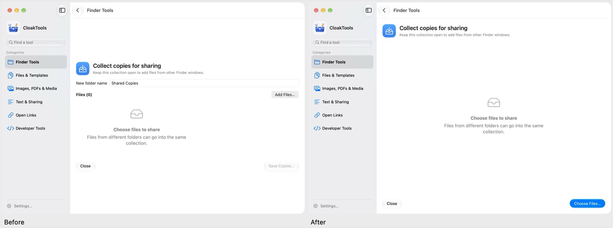

# CloakTools design consistency audit

23 November 2026 · Local development build on Apple silicon, macOS 27.2.1, Xcode 27.2.

## Mac app

The audit covered the 31 distinct Workbench entries across six categories and all seven Settings tabs with Developer Tools enabled. Thirty entries were opened from the running Workbench with an isolated profile. The clipboard-to-file editor was rendered in the app test host with synthetic text to avoid reading the system clipboard. File pickers used generated inputs and a temporary destination. The review also covered first launch, the File menu, menu bar, floating Drop Zone, pipeline editor and default-app review in its simulated system mode.

| Area | Finding and change | Verification |
| --- | --- | --- |
| Folder reviews | Short content let the heading and buttons drift toward the middle of a tall window. The editor now gives spare height to its content. An empty collection starts with **Choose Files…**. Once populated, it shows the name, **Add Files…** and **Save Copies…**. | In the running Workbench, Close and Choose Files were both 20 points above the bottom at 1000 × 700 and 900 × 652. A live collection went from file picker to saved folder and Done. Layout tests also cover 440 × 420 and 700 × 680 point reviews. |
| Secondary actions | Save Recipe used small link text beside large export buttons. Convert Image, Make It Fit and Export Media now use the shared secondary button style. | In each editor, Cancel, Save Recipe and the primary action had the same vertical position and measured 28 points high. The recipe sheet opened and Escape returned to the draft. |
| Running and completed reviews | Eight review views closed their draft when Cancel was pressed during preparation. JSON and Base64 text also showed Close while running. These views now cancel the work in place. A completed folder review could ignore Escape while Done was visible. | A hosted regression cancelled a sample generation, kept its name and options, and generated it again. The live sample and collection both dismissed with Escape after saving. Save publication keeps its existing dismissal guard. |
| Keyboard defaults | File-based review actions looked like default buttons but required Command-Return. File List, Sample Files, Example Copy, Markdown Digest, Read QR and Base64 image encoding now also accept Return. Editable multiline inputs retain Command-Return. | Return generated a sample, Command-Return opened the save sheet, and Escape dismissed the sheet without closing the review. A hosted test checks the alternate keys and the disabled state. |
| Row actions and results | Nine lists used different ellipses, sizes and labels for their item menus. They now share one native ellipsis menu with an item-specific name and tooltip. Seventeen result views use **Show in Finder** with the output filename in its accessibility label. | Inspected the recipe library, folder rules, pipeline steps, and saved sample and collection results. The window accessibility tree reported both the affected item and its action. |
| Menu bar and Drop Zone | The menu bar icon exposed the name of the wrench symbol. It now identifies itself as **CloakTools**. | Read back the menu bar accessibility name, opened the floating panel from the menu, and measured Close and Choose Files on the same baseline in a 300-point-wide panel. |
| Default apps | During a macOS default-handler request, buttons could still appear available. The review now disables its footer while waiting and uses the shared progress and error treatment. | Inspected the simulated default-app review. The operating system’s real default handlers were outside the walkthrough. |

The live screen comparison included light and dark samples, empty and populated reviews, editing sheets, a saved result and native picker handoffs. The shared footer test measures horizontal order at 400 and 660 points. Spoken VoiceOver, non-English localization, every macOS accessibility setting and a first-time user study remain open. The clipboard capture establishes layout and text order. Its offscreen rendering does not reproduce WindowServer glass.

## Public website

Home, Install, Privacy, Support, Source, License and 404 use the pinned Air shell. The audit compared desktop and phone captures and ran the existing layout and focus checks at eleven sizes from 320 × 568 through 1920 × 1080, with both themes, 200% root text at minimum width and reduced motion.

The home page could mark **Privacy** as current even when **Download** had keyboard focus. This reproduced at 1440 × 900 and 1920 × 1080 because the end of the document prevented Download from reaching the scroll threshold. The last navigation section now becomes current at the bottom. Direct navigation and scrolling back to Product passed at five sizes. The browser regression activates both links with the keyboard and verifies the current marker in the desktop and mobile navigation.

| Check | Result |
| --- | --- |
| Local site verification and Worker dry run | Seven routes and 226 local links, assets and anchors. Astro reported zero errors or warnings. |
| Chrome link and focus matrix | 1,080 layout and interaction states and 428 keyboard focus checks. |
| Chromium and WebKit on a 390 × 844 touch viewport | All seven routes in both themes on each engine. Menu tap and Escape restored focus. Contents links focused the selected heading and marked its location. Long contents lists started collapsed. |
| Touch disclosure toggles | 14 menu and eight contents open/close checks across the seven routes and both themes. |
| JavaScript disabled | 14 route/theme checks. Native navigation and contents remained usable. The landing artwork was visible in its settled state. |
| Repository checks | Air design, portability and README validation passed. |

Touch was emulated. Physical devices, spoken announcements and full browser zoom were outside this run. The website and native accessibility checks cover different surfaces.
