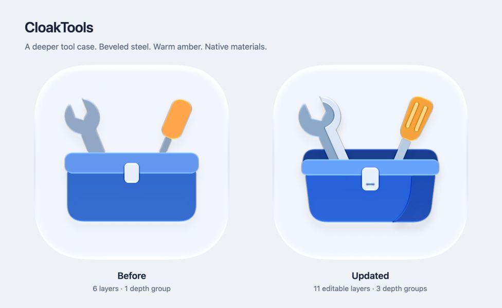

# Layered icon and web mark verification

November 17, 2026. Scope: the editable native identity, its exported appearances,
About artwork, circular website mark, touch icon and shared social card. Work was
performed on `dev`; no push, production deployment or native release was made.

## Design and source

The cobalt case, silver spanner, amber driver and ice ground retain the original
identity. The revision introduces a recessed rear tray, a raised front rim,
beveled spanner, fluted handle, darker case return and a slotted metal latch.
Eleven full-canvas SVG layers form three independently shaded depth groups in
`assets/icon/CloakTools.icon`. The background, shape mask, appearance conversion
and lighting remain native Icon Composer responsibilities.

CloakDrop and CloakRoll's local source and native exports were read-only references.
The web mark preserves the family's circular format and flat vector treatment.
`sync-brand.mjs` now traverses every native group, reversing both group and layer
order for SVG painting; it previously read only the first group. No pinned Air
contract, CSS, component, route or navigation implementation changed.



## Native and asset checks

- `swift scripts/make-app-icon.swift` exported and validated Default, Dark,
  Clear Light/Dark and Tinted Light/Dark at 512 px; Default at 16/32/64/128 px;
  and both About appearances at 256/512 px. All six variants and small-size
  renders were visually inspected. At 16 px, recognition rests on the tool/case
  silhouette and color masses; the grip and latch details are secondary.
- `./scripts/build-native.sh` succeeded, compiling the layered `.icon` and asset
  catalog. The native About pane was opened in the newly built app and the updated
  light icon was visually inspected at its actual 64 pt size. Xcode's existing
  App Intents metadata extraction warning appeared for the extension target.
- A direct assertion checked all eleven SVG bodies in the web mark's expected
  back-to-front order, three native groups, identical source/public/built SVGs,
  idempotent synchronization, matching exported About PNGs, and matching public
  touch/social images. All passed.
- No native behavior changed; core/hosted behavior tests were not rerun. The native
  UI inspection was light appearance only. Dark/clear/tinted checks used Icon
  Composer exports, not a complete live Dock/system-appearance matrix. Tinted Dark
  uses the exporter's default purple tint; arbitrary user tint colors are untested.

## Website verification

Chrome on this Mac, using the local production build and browser device/media
emulation. [Measurements](evidence/icon-2026-11-17/checks.json) and
[all-route visual comparison](evidence/icon-2026-11-17/routes.jpg) are saved.

| Check | Observed result |
|---|---|
| Route/theme/device matrix | 56 combinations: Home, Install, Privacy, Support, Source, License and 404 × light/dark × 390×844, 768×1024, 1280×720 and 1920×1080. No document overflow or broken eager images; one main/H1; five footer links; the new 36px mark loads on every route. Phone/tablet use coarse-pointer emulation. |
| Enlarged text | 28 combinations: all seven routes × both themes × 320/1440px widths at 200% root text size. No document overflow; marks remain 36px. This is text enlargement, not actual browser zoom. |
| Navigation | At 390px, Enter opens Menu; Escape closes it and returns focus to the summary. The summary measures 44px high. Emulated touch opens the same disclosure. |
| Contents | Privacy starts collapsed on the phone. Enter opens all 18 links; selecting QR creation updates the hash and focuses the matching heading. |
| Static motion | Reduced motion keeps the finished document artwork visible and hides replay. With JavaScript disabled, all seven routes at 390px retain their mark and have no horizontal overflow; reading contents stay open. |
| Visual comparison | All seven route headers/initial views compared in both themes at 1280px. Additional phone menu and native before/after captures are saved. |
| Social card | Rebuilt through the unchanged Air template with a 2× settled-artwork crop, the updated SVG mark and a 1× 1200×630 PNG. All template regions remain within the canvas. Source/public/build bytes and OG/Twitter metadata match; the image URL is versioned `icon-2026-11-17`. |

The social export used browser control with the same template, crop and dimensions
as `docs/air/render-social.mjs`. The standalone Puppeteer renderer was not run.
All temporary browser emulation was restored and temporary review pages removed.

Commands passed:

```sh
node scripts/check-air-design.mjs
node scripts/check-air-portability.mjs
node scripts/check-readmes.mjs
npm --prefix apps/site run verify
npm --prefix apps/site run check:worker
git diff --check
```

Astro reported no errors, warnings or hints. Static acceptance checked seven
routes and 224 local links/assets/anchors; the Worker bundle passed its dry run.
The social card is 57 KiB. The checked-in Air hashes and standalone portability
checks remain intact. Modern Web Guidance was scoped out: this change updates
vector assets and their build-time synchronization, without HTML/CSS or client
interaction changes.

These are bounded identity/regression checks, not native accessibility or whole-app
certification. Physical phones/tablets, Safari/Firefox, spoken screen readers,
forced colors and the full breakpoint/zoom matrix were not rerun. Source release
claims remain a development preview with no public installer. The previous
[website audit](AUDIT-2026-11-17.md) and
[native audit](../verification/ROADMAP-IMPLEMENTATION.md) retain their own scopes.

Additional images: [desktop dark](evidence/icon-2026-11-17/home-dark.jpg),
[phone menu](evidence/icon-2026-11-17/phone-menu-dark.jpg),
[social card](../../assets/social/og.png).
