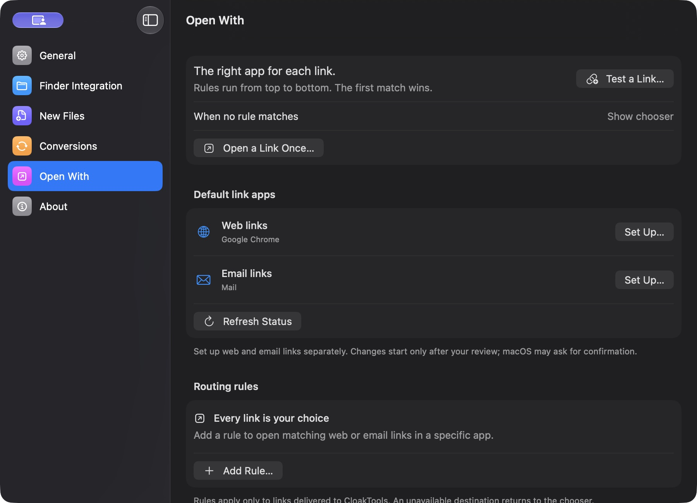
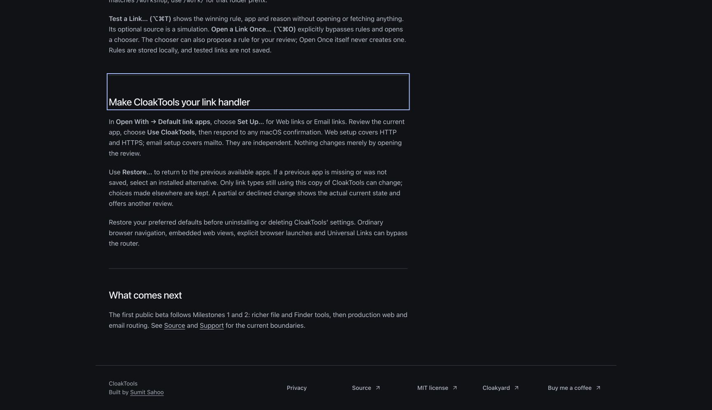

# Default link apps — 0.2.1 (8)

Verified 15 November 2026 on Apple silicon, macOS 27.2.1, Xcode 27.2 / macOS 27.2 SDK. This slice adds independent web/email default setup, current status and guarded restoration. It advances Milestone 2; it does not complete the public beta or installer lifecycle checks.

## Implemented behavior

- Open With shows separate Web links and Email links rows with actual system defaults. Mixed HTTP/HTTPS defaults are shown explicitly.
- Set Up opens a read-only review. Only **Use CloakTools** saves prior app identities and requests a system change. Both web schemes are recorded before the first request because macOS may change them together.
- Restore preselects available previous apps. A missing or unknown previous app requires an explicit compatible alternative. Only schemes still owned by this copy of CloakTools are eligible; choices made elsewhere are kept.
- Reviews capture current state and recovery history. Execution checks both again, serializes requests across asynchronous system consent, verifies actual defaults after each request, and stops after a failure or unexpected change. Partial results show current apps and offer Review Again.
- Versioned, bounded, atomically written `default-handlers.json` stores scheme and app identity/name/path, without URL history. Successful restoration removes consumed records. Concurrent newer history is preserved.
- Web and email are independent. Launch, status refresh, rule editing and ordinary cancellation do not change defaults.

## Approved live system test

The user explicitly approved temporarily setting CloakTools for both roles and then restoring **Google Chrome and Mail**.

1. Independent NSWorkspace discovery confirmed Chrome for HTTP/HTTPS and Mail for mailto. Opening and cancelling the initial setup review did not create a recovery file or change defaults.
2. Web Set Up → Use CloakTools displayed a waiting state and the macOS browser confirmation. After Use CloakTools, independent discovery confirmed both HTTP and HTTPS had changed together. Both prior Chrome records were saved; email remained Mail.
3. A normal `open 'https://example.com/cloaktools-default-proof?source=normal-launch'`, without an explicit app argument, reached the CloakTools chooser with the original URL. Cancelled before destination dispatch.
4. Email Set Up → Use CloakTools completed; this Mac did not display another OS prompt. Independent discovery confirmed mailto now used CloakTools.
5. A normal synthetic mailto launch, without an explicit app argument, reached the email chooser with the encoded subject/body preserved and Mail available. Cancelled without opening a draft or sending mail.
6. Quit and relaunched CloakTools while it owned the defaults. Status and restoration records survived. Web Restore preselected Chrome for both schemes.
7. Restore Apps → macOS Use Chrome restored HTTP/HTTPS while email remained CloakTools. Email Restore preselected Mail and restored it independently.
8. Independent discovery confirmed **HTTP/HTTPS → `com.google.Chrome` at `/Applications/Google Chrome.app`; mailto → `com.apple.mail` at `/System/Applications/Mail.app`**. Recovery history contained an empty `points` array. No test rules remained.

The final normal app runs in system appearance with Chrome/Mail shown, original file preferences retained, and no preview fixture active.

[Web setup](../../assets/screenshots/default-web-setup-dark.png) · [Email setup](../../assets/screenshots/default-email-setup-dark.png) · [Web restoration](../../assets/screenshots/default-web-restore-dark.png)

## Compact UI and isolated preview

The web review is **460 × 380 pt**; email is **460 × 330 pt**. Reading cards remain opaque, with native Glass actions and a scrollable body. The verified result layout uses full-width status rows and contracts to **460 × 300 pt** for web or **460 × 280 pt** for email. Return dismisses a completed result; Escape cancels a review. Controls and dismissal are disabled while a system request is pending.

After restoring the real defaults, a clearly labeled DEBUG-only `--preview-default-handlers` fixture exercised the missing-previous-browser state in light appearance. Restore stayed disabled until Chrome was explicitly selected. The resulting compact success panel was inspected and dismissed with Return. This fixture changes an in-memory system adapter and a unique temporary history file only; it never invokes the system setter. Its temporary file was removed and the normal app relaunched. Release compilation excludes the fixture.

[Missing app, isolated light preview](../../assets/screenshots/default-restore-missing-preview-light.png) · [Final result layout, isolated light preview](../../assets/screenshots/default-result-preview-light.png)

`default-web-enabled-dark.png` is earlier live-test evidence; its result layout predates the final width/height polish and is not the final design reference.

## Automated and website checks

| Check | Result |
| --- | --- |
| `GIT_CONFIG_COUNT=0 swift test --package-path apps/macos/Packages/CloakToolsCore` | **71 tests passed** |
| `GIT_CONFIG_COUNT=0 ./scripts/build-native.sh` | Debug host and embedded Finder extension built, **0.2.1 (8)** |
| Release `xcodebuild`, arm64, separate `ReleaseVerify` output | **BUILD SUCCEEDED**; Release app was not run |
| `npm --prefix apps/site run verify` | Astro checks/build and all 7 pages' links/assets/metadata/landmarks/pinned-Air checks passed |

Fifteen new coordinator/storage tests cover read-only review, prewrite snapshots, denied consent, partial failure/retry, OS-coupled schemes, independent roles, external choices, unavailable/moved apps, stale state/history, unexpected changes during consent, callback success without observed change, persistence failures, concurrent requests/history edits, unknown prior apps, other CloakTools copies and bounded/corrupt storage. These are isolated tests; the live test above establishes successful real OS integration, not every failure scenario.

No Swift compiler warnings occurred. Expected unused AppIntents metadata warnings and ad-hoc signing notes remain. The existing malformed PDF test emits its expected native parser diagnostic. Logs: [core](default-handlers-core.txt), [build summary](default-handlers-build.txt), [website](default-handlers-site.txt).

Install, Support, Home, Source and Privacy describe the new explicit flow while retaining the Cloakyard Air shell and app-specific animation. Desktop guide width matched its 1,728 px viewport. Install and Support were visually reviewed at 320 px, with document width equal to viewport width and no horizontal overflow. The temporary viewport override was reset, the browser tab closed and the owned development server stopped.

## Remaining boundaries

- NSWorkspace has no atomic multi-scheme transaction or conditional compare-and-swap. An external change during an outstanding OS consent prompt remains a race boundary; observed unexpected changes stop subsequent requests. There is no speculative rollback.
- Damaged recovery data blocks app-driven setup/restoration until repaired; the user can restore through their preferred browser/mail app. No real recovery file was deliberately corrupted during the approved live test.
- macOS 27.0 specifically, other browser/mail configurations, full VoiceOver and system accessibility settings, localized long labels, installer/uninstaller lifecycle, signing/notarization and cross-volume/provider behavior remain release checks.
- Configurable Finder scopes still require supported app-group signing. Existing scoped Finder and Services paths remain; see the [access matrix](../FINDER-ACCESS.md).
- Broader destination management and configurable fallback are the next Open With work. Edge was unavailable; application/profile behavior still requires real cold/running verification. See [Open With](../OPEN-WITH.md) and the [roadmap](../ROADMAP.md).
