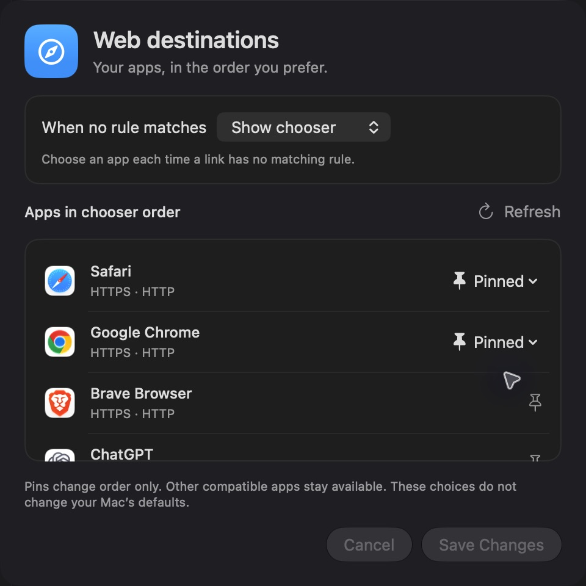
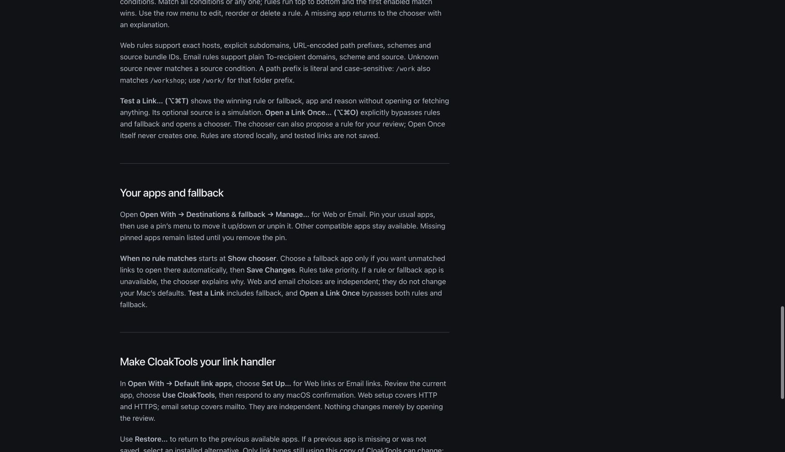

# Destinations and fallback — 0.2.2 (9)

Verified 15 November 2026 on Apple silicon, macOS 27.2.1, Xcode 27.2 / macOS 27.2 SDK. This slice adds destination management and explicit fallback choices to Milestone 2. The earlier approved [default-handler setup/restoration test](DEFAULT-HANDLERS.md) completed with Chrome and Mail restored.

## Implemented behavior

- Separate Web and Email management sheets show compatible installed apps, real icons and supported schemes. Pin up to 32 apps per role, move pins up/down or unpin them. Pins lead the chooser and rule destination picker; other compatible apps remain available.
- Each role starts with **Show chooser**. Selecting an app under **When no rule matches**, then **Save Changes**, explicitly enables automatic fallback for that role. The sheet explains that effect. Cancel discards the draft.
- Precedence is one-time bypass, first matching enabled rule, then configured fallback. An unavailable matching rule never falls through to the fallback app. Missing fallback apps return to an explanatory chooser.
- The same evaluator drives actual incoming links and Test a Link. Incoming events snapshot rules and destination preferences before queueing; dispatch rechecks compatibility for the actual URL, app identity and self-exclusion.
- Missing saved apps stay visible in management. Pin order affects presentation only and never introduces unavailable apps into the chooser. Fallback/pin settings do not change macOS defaults, browser profiles or mail accounts.
- `routing-destinations.json` is versioned, atomically saved and bounded to 64 KiB. It contains app names/identifiers and order, without URLs. Same-role stale edits are rejected; newer other-role edits are preserved. Unreadable settings stop automatic routing at the chooser. Refresh Status reloads routing and default status.

## Native and integration observations

1. Opening and cancelling the manager did not create a destination preferences file. Save remained disabled until a draft changed.
2. Pinned Chrome and Safari, then used Safari’s native pin menu to move it above Chrome. The compact sheet showed that order and retained other compatible apps below it. Selected the separate synthetic RoutingProbe as web fallback and saved; email remained Show chooser. Configured the email fallback independently, then quit CloakTools.
3. Neither CloakTools nor the test receiver was running before the next delivery. Explicitly sent synthetic HTTPS and mailto URLs to CloakTools. Both reached the receiver with exact original query, fragment, cc, subject, CRLF body, plus and ampersand encoding. Saved configuration survived the host restart. The host reported **Fallback → RoutingProbe**. [Received synthetic events](destination-events.json) record the evidence. No message was sent and no browser request was needed.
4. Test a Link displayed the configured web fallback and reason. Enabling bypass changed the result to Show chooser with both rules and fallback bypassed. The receiver log contained neither tester input nor the later bypass URL.
5. **Open a Link Once (⌥⌘O)** with fallback configured opened the chooser. Safari appeared first, Chrome second, then the remaining apps. Cancelled without dispatch.
6. The receiver returned a synthetic loop URL to CloakTools. The chooser displayed **Automatic reopening was stopped**. The receiver recorded that URL exactly once, demonstrating that fallback uses the existing loop guard.
7. Saved a pin for the test receiver, stopped/unregistered it, and moved its bundle out of the build location. In light appearance, both role summaries reported unavailable fallback; the manager retained its missing pin with a text explanation. A real incoming URL opened the chooser, named the unavailable fallback and excluded the missing receiver.
8. Removed only the verified settings created for this test and relaunched without an appearance override. Both roles returned to Show chooser with no pins or rules. The test receiver remains stopped/unregistered; it is never embedded in CloakTools.
9. Created a temporary malformed destination file only after confirming the original file was absent. Settings displayed the read error and disabled management. A real incoming URL opened the chooser with the settings-read explanation. Removed that exact test file and clicked Refresh Status; the warning cleared and both Manage buttons re-enabled. No user destination data was overwritten.

The final app runs in normal system appearance, Open With, with no pending dialogs, test destinations or appearance overrides. The Mac’s defaults remain **Chrome for HTTP/HTTPS and Mail for mailto**. Existing file preferences and templates remain intact.

## Design evidence

The manager is **480 × 480 pt** with a full-width fallback card, a scrollable app list and fixed native Glass actions. Native app labels and supported schemes are combined for accessibility. Screenshots are real UI captures; the missing-app example uses the separate synthetic receiver described above.

[Pinned chooser order](../../assets/screenshots/destinations-chooser-dark.png) · [Missing app in light appearance](../../assets/screenshots/destinations-unavailable-light.png) · [Final settings](../../assets/screenshots/destinations-settings-dark.png)

## Automated and website checks

| Command | Result |
| --- | --- |
| `GIT_CONFIG_COUNT=0 swift test --package-path apps/macos/Packages/CloakToolsCore` | **80 tests passed** |
| `GIT_CONFIG_COUNT=0 ./scripts/build-native.sh` | Debug host and embedded Finder extension, **0.2.2 (9)**, **BUILD SUCCEEDED** |
| `npm --prefix apps/site run verify` | Astro checks/build and 7-page links/assets/metadata/landmarks/pinned-Air validation passed |

Nine new core tests cover initial chooser defaults, role independence, rule/bypass precedence, missing/invalid rules and fallback, original mailto preservation, pin presentation without routing, immutable snapshots, durable round-trip storage, stale edits, other-role preservation, storage bounds/corruption and invalid/self references. Earlier 71 tests still pass. No Swift compiler warnings occurred; expected unused AppIntents metadata warnings and ad-hoc signing notes remain.

Logs: [core](destinations-core.txt), [native build summary](destinations-build.txt), [website](destinations-site.txt).

Home, Install, Support, Source and Privacy reflect destination preferences while retaining the Cloakyard Air layout and existing app animation. Browser review checked the desktop guide at 1,728 px and Install/Support at 320 px; document width matched viewport width with no horizontal overflow. Temporary viewport overrides were reset, the verification tab closed and the owned dev server stopped.

## Remaining gates

- Edge is unavailable on this Mac. Edge application/profile behavior still requires real cold/running checks. No profile/account destination is exposed and no browser was installed for verification.
- Full VoiceOver and system accessibility settings, localized long names, macOS 27.0 runtime, signing/notarization, installer/extension lifecycle and configurable Finder scopes remain release gates. Current visual/keyboard observations are not a complete accessibility audit.
- Saved bundle identities deliberately follow Launch Services’ preferred compatible installed copy, not a pinned executable path. Atomic file replacement is not a cross-process compare-and-swap; simultaneous external edits during the narrow load/write interval remain a storage boundary.
- Milestone 2 and the first public beta are not marked complete. The next independently actionable feature is Milestone 3’s Make It Fit: native image format, dimensions and maximum-byte output requirements.
