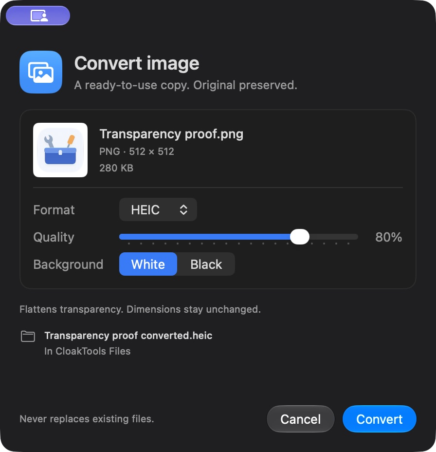
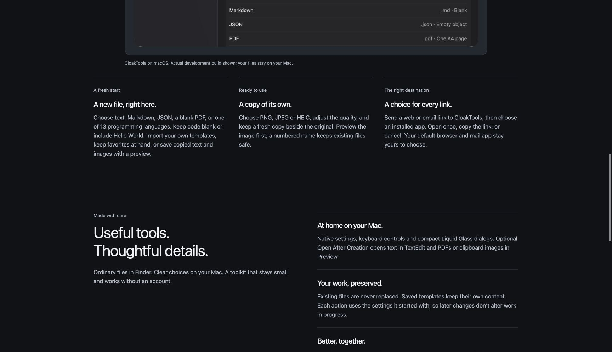

# Native image conversion — 0.1.2 (4)

Verified 15 November 2026 on Apple silicon, macOS 27.2.1 (26B131), Xcode 27.2 (27B52), macOS 27.2 SDK and Swift 6.4.2. This completes the basic image-conversion slice of Milestone 1. PDF assembly, Copy As and configurable Finder scopes remain future work.

## Implemented behavior

- Content-validated, single-frame PNG/JPEG/TIFF/HEIC input; PNG/JPEG/HEIC output through native ImageIO. Encoded inputs are bounded to 100 MB and decoded dimensions to 40 megapixels.
- PNG retains transparency. JPEG and HEIC composite onto white or black and expose 10–100% native quality. Quality does not promise a target byte count.
- Output is orientation-applied 8-bit sRGB/SDR. Higher bit depth, HDR/gain maps, depth and original camera/location metadata are not preserved. Lossless PNG compression applies to the normalized pixels.
- Runtime discovery disables unavailable output encoders. This Mac successfully encoded and decoded all three formats, including HEIC.
- Bounded source reads and full pixel preparation happen on a worker before confirmation. The preview and published copy share an immutable pixel capture; no source reread occurs at Convert.
- Saved defaults are captured per operation. Adjusting one conversion does not edit defaults; changing defaults does not alter pending work.
- Exclusive publication writes a distinct copy beside the source. Collisions advance a numbered suffix. Cancellation checks surround native work and precede publication. The existing source remains unchanged.
- Finder menus, Services, General quick actions, Conversions settings and File → Convert Image… use the same host coordinator. The shortcut is ⇧⌘K. Completed copies can be opened explicitly in Preview.

The dialog opens at **448 × 432 pt** of content. The source card, format, quality, background, output name and destination fit without scrolling for the verified file. Completed operations collapse the controls so success, Reveal in Finder and Open in Preview remain visible. Native Glass footer buttons retain existing accessibility fallbacks; content uses semantic control surfaces. Long filenames/errors and smaller resized windows can scroll.

## Native integration observed

1. Registered and enabled the built Finder extension. The actual context menu for `Transparency proof.png` displayed **Convert Image with CloakTools…**, and Services displayed its corresponding command. Invoking the extension action opened the prepared 512 × 512 preview with PNG as the initial format.
2. Selected JPEG, set quality to 75%, and selected Black. The thumbnail reflected the background. Return created `Transparency proof converted.jpg`; Open in Preview opened that exact URL. Preview visibly rendered the image with black corners.
3. Set Conversions defaults to HEIC, 80%, White; quit/relaunched the app. The next operation restored those values. While it remained open, changed defaults back to PNG, 90%, White. The pending operation retained HEIC, 80%, White and produced `Transparency proof converted.heic`. Preview opened and rendered that exact file with white corners.
4. Used the native Choose an Image panel to select that HEIC. The next dialog used the restored PNG default and created `Transparency proof converted converted.png`; Preview opened it successfully. Independently checked all three outputs with `sips`: correct actual formats and 512 × 512 dimensions; JPEG/HEIC have no alpha.
5. Compared the original PNG's SHA-256 against the source fixture `assets/icon/Previews/Default-512.png`: unchanged. Actual outputs were 22,594 bytes JPEG, 5,698 bytes HEIC and 95,940 bytes round-trip PNG. These sizes describe this fixture only.
6. Delivered a synthetic invalid HEIC file through the action URL. The dialog showed **Preview unavailable**, an actionable supported-format error, and disabled Convert. Escape closed it; no output was published. Escape also cancelled an earlier valid preview without publication. ⇧⌘K opened the actual native picker; Escape dismissed it.
7. Left the final app running in Conversions with normal system appearance and defaults restored to PNG / 90% / White, Reveal On. The existing Hello World and Open After Creation preferences were retained. Test Preview documents were closed; unrelated documents were left alone.

## Automated checks

| Check | Result |
| --- | --- |
| `GIT_CONFIG_COUNT=0 swift test --package-path apps/macos/Packages/CloakToolsCore` | **34 tests passed** |
| `./scripts/build-native.sh` | Host app and embedded Finder extension built successfully, Debug arm64 |
| `npm --prefix apps/site run verify` | Astro checks/build; **7 pages**, links/assets, metadata, landmarks and pinned Air hashes passed |

Eight new image tests cover all twelve input/output directions, valid decoding and unchanged originals, numbered collisions, PNG alpha and white/black lossy pixels, EXIF orientation and camera/location metadata exclusion, changed/deleted sources after capture, quality validation and encoder behavior, malformed/multiple-frame rejection, preference migration/snapshots, and cancellation without publication. Existing tests continue to cover clipboard/template behavior, 24 concurrent output collisions, URL handling and creation settings.

Logs: [core tests](image-conversion-native-core.txt), [build summary](image-conversion-build.txt), [site verification](image-conversion-site-verification.txt). The build has the expected unused AppIntents metadata-extraction warning and local ad-hoc signing notes; no Swift compiler warnings or errors were reported.

Website copy now reflects the supported conversion formats, controls and limits across Home, Install, Support, Source and Privacy. Browser inspection verified the desktop feature section and 320 px Home/Install/Support widths with no horizontal overflow. The existing Air design and finite artwork animation are unchanged. Temporary viewport overrides were reset and the owned development server was stopped.

## Visual evidence

[JPEG controls in light appearance](../../assets/screenshots/conversion-jpeg-light.png) · [Conversions defaults](../../assets/screenshots/conversions-settings-dark.png) · [Completed copy](../../assets/screenshots/conversion-result-dark.png) · [Invalid-image feedback](../../assets/screenshots/conversion-error-dark.png)

[Mobile support page](../../assets/screenshots/conversion-site-mobile.jpg)

## Remaining limits

This is a local ad-hoc build, not a notarized release. macOS 27.0 specifically, unavailable-encoder UI on other machines, broad real-world HEIC/HDR/color-profile fixtures, memory use at maximum image limits, full VoiceOver/system accessibility settings, unusual filesystems and extension installation lifecycle remain release checks. Multi-image HEIC, multi-page TIFF, animation, RAW, resizing, byte-size targets and batch conversion are not offered. Cancellation cannot interrupt an ImageIO call; it is cooperative around it. Abrupt-crash staging recovery remains unimplemented. No site, repository or installer was published.
