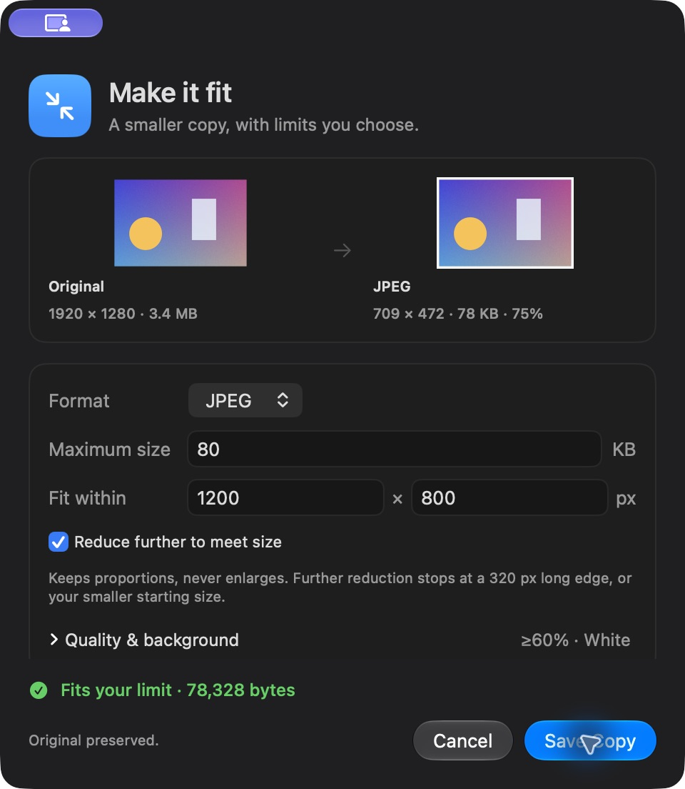
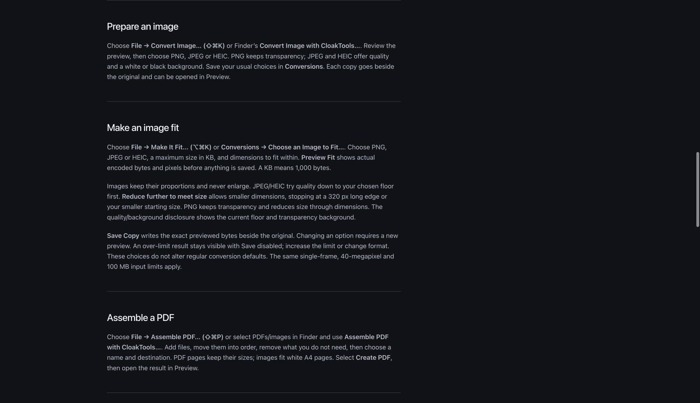

# Make It Fit — 0.3.0 (10)

Verified 15 November 2026 on Apple silicon, macOS 27.2.1, Xcode 27.2 / macOS 27.2 SDK. This slice starts Milestone 3 with measured native image fitting. It does not mark the earlier release gates or the public beta complete.

## Working behavior

- File → **Make It Fit… (⌥⌘K)**, General Quick Actions and Conversions open the native image picker and compact fitting window.
- Choose PNG/JPEG/HEIC, a decimal KB budget and maximum width/height. Defaults are JPEG, 500 KB, 1600 × 1600 px, a 60% quality floor, white background and further reduction enabled. Fit choices are local to the operation and leave conversion defaults unchanged.
- Preview captures actual encoded bytes, dimensions and quality. Images never enlarge; the initial image fits the requested box, with aspect ratio rounded to whole pixels. JPEG/HEIC try quality before smaller dimensions. PNG retains transparency and uses dimensions for size reduction.
- Optional further reduction stops at a 320 px long edge, or the smaller initial bounded size. At most eight dimension levels and 21 candidate encodes keep the search bounded. The result is measured, not a prediction or a guarantee of mathematically optimal dimensions/quality.
- Save is enabled only for a passing result and writes exactly the reviewed bytes through SafeOutput, beside the original with a ` fit` suffix and collision numbering. Option changes invalidate the preview, and Save independently checks that its options still match. Source changes after capture cannot alter the output.
- Preview writes no image files. Failed targets remain visible but cannot be published. Work runs off the main actor; cancellation is checked around native steps and before publication. An active synchronous encoder call finishes before cancellation can be observed.

## Native observations

1. Generated an isolated synthetic source using `scripts/make-fit-verification-fixture.swift`. `Spectrum.png` was **3,410,448 bytes at 1920 × 1280**, with a textured color field, simple geometry and transparent edges. No personal image was used.
2. Opened the action through Conversions and the **⌥⌘K** shortcut, then selected the image through the actual native open panel. The default JPEG preview measured 487,623 bytes at 1600 × 1066. Cancelled it without writing a copy.
3. Entering 0 KB and pressing Return displayed input validation. A **1 KB PNG** target produced a reviewable **88,336-byte, 320 × 213** result with Save Copy disabled. Directory inspection confirmed that preview, invalid input and failed fitting had created no output files.
4. Changed to **JPEG, 80 KB, within 1200 × 800**, retaining the 60% floor and further reduction. Editing limits cleared the old result and restored Preview Fit. The new measured result was **78,328 bytes at 709 × 472**, with a displayed 75% encoding setting.
5. Save Copy wrote `Spectrum fit.jpg`. The explicit Open in Preview action opened the actual output successfully. Independent ImageIO decoding confirmed JPEG, exact byte count and dimensions. The original SHA-256 remained unchanged. [Output evidence](make-fit-output.txt) records the measurements.
6. Inspected dark and light appearances. The final 480 × 520 pt window keeps fit status, errors, activity and actions outside the scrollable body. The quality/background disclosure shows current values when collapsed. In light appearance, changed the quality floor to 80% and background to Black through native controls, then verified the final PNG failure wording and disabled Save. Escape cancelled the operation without another file.
7. Closed only the verification image in Preview, retaining the pre-existing document. Relaunched CloakTools without its app-only light override. The final app is in Conversions, with no active fitting operation. Existing PNG/90%/white conversion defaults, Hello World Off and Open After Creation Off remain unchanged. The Finder extension was re-registered after the build. The synthetic source and successful output remain in `/tmp/CloakTools-Fit-Verification` for inspection.

[Over-limit result in light appearance](../../assets/screenshots/make-fit-over-limit-light.png) · [Actual output opened in Preview](../../assets/screenshots/make-fit-open-preview.png)

## Automated checks

| Command | Result |
| --- | --- |
| `GIT_CONFIG_COUNT=0 swift test --package-path apps/macos/Packages/CloakToolsCore` | **90 tests passed** |
| `GIT_CONFIG_COUNT=0 ./scripts/build-native.sh` | Debug host and embedded Finder extension, **0.3.0 (10)**, **BUILD SUCCEEDED** |
| `npm --prefix apps/site run verify` | Astro checks/build and 7-page links/assets/metadata/landmarks/pinned-Air validation passed |

Ten new fitting tests cover no enlargement and bounded dimensions, quality-before-reduction and its floor, PNG reduction against actual bytes, unsatisfied targets and publication refusal, disabled further reduction and small starting sizes, alpha/white/black output across native encoders, orientation and metadata, exact-byte saving after source modification/deletion, collision naming, invalid/overflowing bounds, finite quality and cancellation without publication. Earlier 80 tests remain passing. Native PNG/JPEG/HEIC output was decoded in the tests. No Swift compiler warnings occurred; expected unused AppIntents metadata warnings and ad-hoc signing notes remain.

Logs: [core](make-fit-core.txt), [native build summary](make-fit-build.txt), [website](make-fit-site.txt).

## Website and documentation

Home, Install, Support, Source and Privacy describe the fitting workflow and limitations while preserving the existing Cloakyard Air design and app animation. Browser review checked the guide at 1,728 px and Install/Support at 320 px; document width matched viewport width and no horizontal overflow was observed. The temporary viewport override was reset, the verification tab closed and the owned development server stopped.

The [format contract](../FORMATS.md), [architecture](../../ARCHITECTURE.md), [design](../../NATIVE_DESIGN.md) and [README](../../README.md) distinguish normal conversion settings from per-operation fitting requirements.

## Remaining boundaries

- The fitter is a bounded search, not a global optimization. Native codec output can vary across OS versions. Quality is an encoder setting, not a perceptual-quality score. Dimension rounding can change proportions by a pixel.
- Input remains single-frame PNG/JPEG/TIFF/HEIC, at most 40 megapixels and 100 MB. Output remains normalized 8-bit sRGB/SDR without original camera/location metadata. No animation, RAW, HDR/depth preservation, exact dimension stretching or enlargement is added.
- No dedicated Finder menu/Service was added for this action; existing Finder integration remains unchanged. Configurable Finder scopes still depend on supported app-group signing.
- A full VoiceOver/system accessibility audit, long localized labels, worst-case 40 MP memory/latency and mid-native-encode cancellation timing, macOS 27.0 runtime, filesystem/provider coverage, signing/notarization and installer lifecycle remain release checks.
- Edge/profile routing remains unverified because Edge is not installed. The next independently actionable Milestone 3 task is PDF page organization: selecting, rotating and exporting pages while preserving the source.
