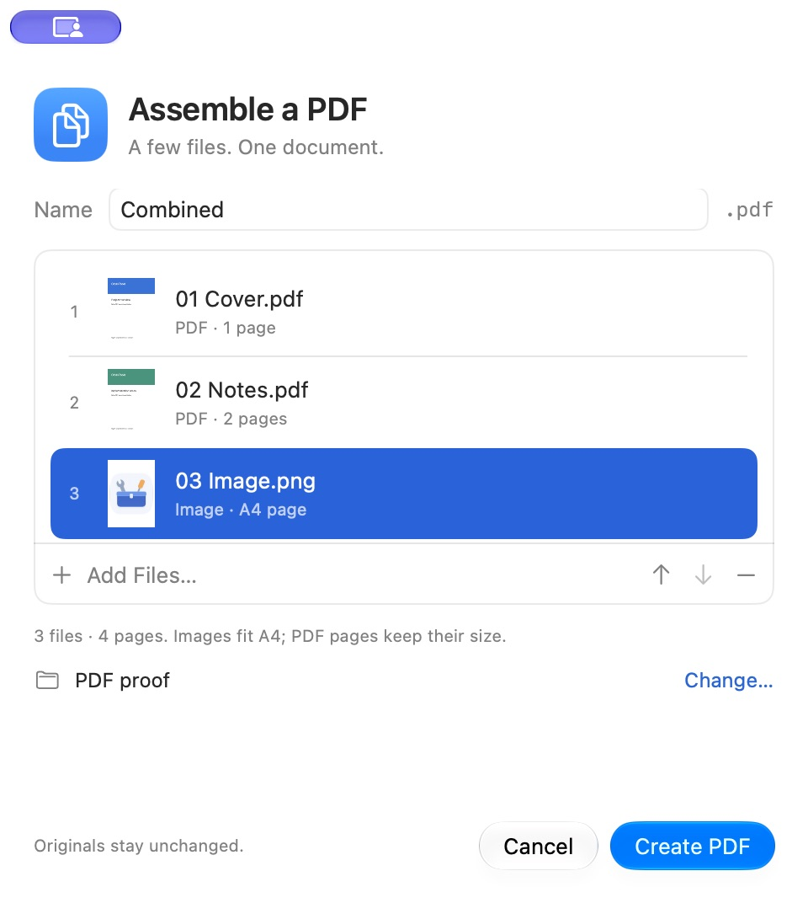
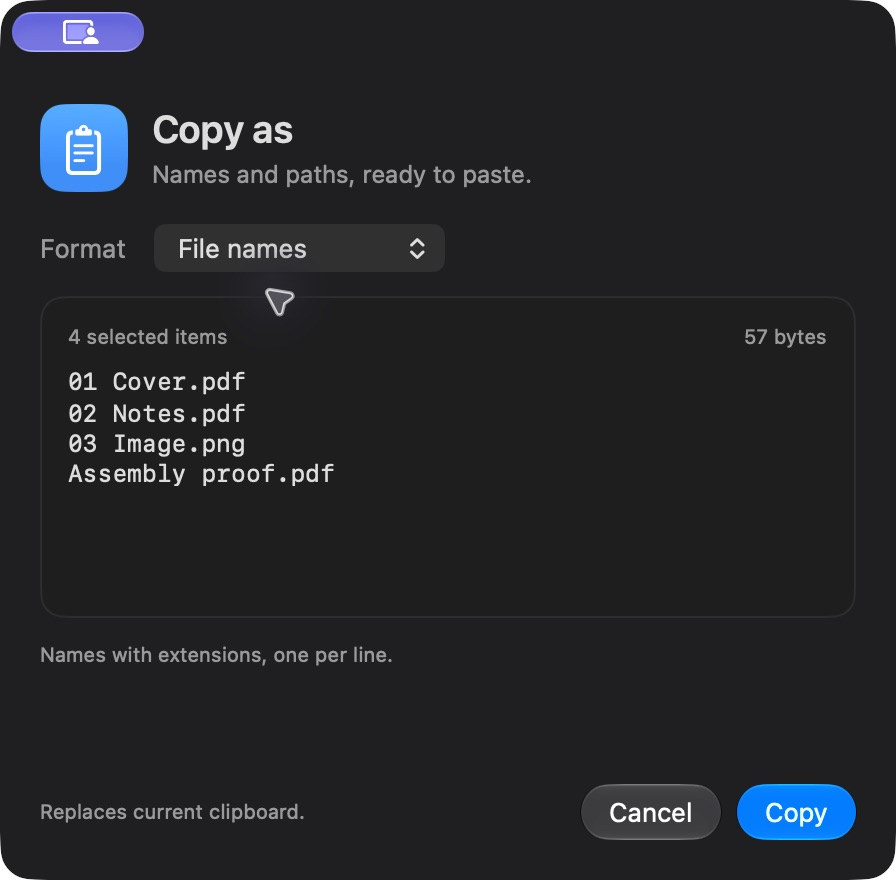
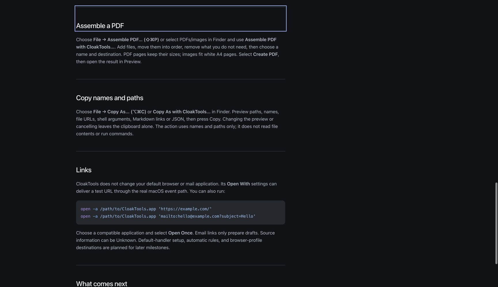

# PDF assembly and Copy As — 0.1.4 (6)

Verified 15 November 2026 on Apple silicon, macOS 27.2.1, Xcode 27.2 / macOS 27.2 SDK. PDF assembly was implemented and exercised first, then Copy As. Both are included in the final running build. Configurable Finder scopes and their permission/lifecycle review remain Milestone 1 work; public beta is not complete.

## PDF assembly

**Assemble PDF…** is available in File (⇧⌘P), General, Conversions, scoped Finder menus and Finder Services. The host owns the review window and all processing; Finder only sends bounded ordered paths.

- Combine ordinary PDFs and PNG/JPEG/TIFF/HEIC images. Reorder whole files, remove selections, add files and choose a name/destination before publication.
- Capture source bytes once. Additions either succeed as a complete group or keep the previous list unchanged. Subsequent source edits/removal do not change a prepared document.
- PDFKit copies pages into a fresh document, preserving page text, media/crop boxes, rotation and page annotations. Separate worker-local document instances are used; PDFKit objects never cross actors.
- Images become centered portrait/landscape A4 pages with a white background and 24-point margins. Their pixels use the existing orientation-applied, 8-bit sRGB pipeline.
- Limits: 32 files, 200 pages, 100 MB per source, 200 MB total source bytes/prepared bytes/output, and 40 megapixels per image. Encrypted/restricted PDFs, AcroForm/widgets and document-signature structures are rejected. Document-level bookmarks/structures are not merged; internal navigation links are not guaranteed. This action is not a PDF metadata scrubber or page editor.
- SafeOutput supplies exclusive publication and numbered collisions. General Reveal/Open After Creation preferences are captured at ingress. Preview is the explicit viewer.

The **480 × 504 pt** review window uses a native source list, first-page thumbnails, page counts, small Add/Move/Remove controls and Glass footer buttons. Source order and destination fit at the default size. Status/errors can scroll; completed output gets a dedicated compact result card.

### Native observations

1. Generated synthetic inputs with `swift scripts/make-pdf-verification-fixtures.swift`: one cover PDF, a two-page notes PDF and a transparent PNG in `~/CloakTools Files/PDF proof`. The helper preserves existing files.
2. Selected all three in actual Finder. **Assemble PDF with CloakTools…** opened a native review showing three files and four pages, sorted by filename.
3. Renamed the output to `Assembly proof`, moved the notes ahead of the cover, removed the image, then re-added it through the native multi-file panel. The review showed Notes → Cover → Image and four pages.
4. Return created **Assembly proof.pdf**. **Open in Preview** opened that exact file, with four pages and selectable text in the requested order: Implementation notes → Verification results → Project overview → image.
5. Independent `pdfinfo` inspection reported four pages, 137,276 bytes, no encryption, no forms and no JavaScript. Poppler rendered **all four pages**, each inspected for clipping, rotation, spacing and image placement. PDFKit/Preview and automated assertions verified the text; `pdftotext` was unavailable and was not used as evidence.

[Preview evidence](../../assets/screenshots/pdf-assembly-preview.png) · [Rendered page 1](../../assets/screenshots/pdf-assembly-page-1.png) · [Page 2](../../assets/screenshots/pdf-assembly-page-2.png) · [Page 3](../../assets/screenshots/pdf-assembly-page-3.png) · [Page 4](../../assets/screenshots/pdf-assembly-page-4.png)

## Copy As

**Copy As…** is available in File (⌥⌘C), General, Finder Integration, scoped Finder menus and Finder Services. Blank-space Finder invocation uses the folder itself; selected-item invocation uses the selected files/folders. Finder/Services sort selections by filename.

Six formats are implemented: full paths, names, file URLs, shell arguments, Markdown links and JSON path lists. The formatter reads no files, resolves no symlinks, traverses no folders and launches no commands. It accepts 1–200 local URLs with bounded paths and caps output at 1 MiB. Preview text is limited to 8,192 characters; Copy writes the complete result. JSON is the unambiguous choice for filenames containing line breaks. Shell strings are single-quoted arguments for sh/bash/zsh, without an added command.

The **448 × 408 pt** window shows format, item/byte counts and a monospace preview. Long lines scroll inside the card. Only Copy clears/writes the system pasteboard; changing formats or cancelling does not. No previous clipboard content is read or retained. Copy stays the default Return action after success; Done/Cancel dismiss separately with Escape. This avoids closing the window when a format change is followed quickly by Return.

### Native observations

1. Selected four synthetic files in Finder. The actual context menu showed **Copy As with CloakTools…**, plus the assembly and Services entries. Copy As opened the correct four-item path preview.
2. Switched to File names, copied, and pasted into a new TextEdit scratch document. The four filenames appeared exactly, one per line. The scratch was saved under `/tmp`; no cloud document was saved and no unrelated document was edited.
3. Switched to JSON, explicitly copied, then selected File URLs and cancelled before copying again. Pasting into `/tmp/CloakTools copy verification.txt` still produced the prior JSON. Parsed those saved bytes independently and compared all four paths/order with the selected files: exact match.
4. Exercised rapid format switching after copying. The final implementation retains Copy as the default action and does not close the window. Confirmed normal Return copies the selected format and Escape dismisses it. ⌥⌘C opened the native file/folder picker; Escape cancelled it.
5. Left the final app running in General with normal system appearance and both new quick actions available. Existing preferences were retained. Native test documents were closed; unrelated documents were left alone. The clipboard contains synthetic verification paths from the explicit Copy tests.

[General quick actions](../../assets/screenshots/general-pdf-copy-dark.png)

## Automated verification

| Check | Result |
| --- | --- |
| `GIT_CONFIG_COUNT=0 swift test --package-path apps/macos/Packages/CloakToolsCore` | **47 tests passed** |
| `./scripts/build-native.sh` | Host app and embedded Finder extension built successfully, Debug arm64 |
| `npm --prefix apps/site run verify` | Astro checks/build; **7 pages**, links/assets, metadata, landmarks and pinned Air hashes passed |

Seven new PDF tests cover page order, text, boxes, rotation, annotations, originals, collisions, immutable capture, additive preparation, A4 images, previews, protected/forms/malformed/oversized inputs, cancellation and intent validation. Six new Copy As tests cover Unicode, encoded URL round trips, JSON, POSIX quoting as data without executing a shell, escaped Markdown, no filesystem reads/symlink resolution, bounds and ordered intent validation. Earlier image/clipboard/template/routing tests continue to pass.

Annotation fixtures are created on the main actor while preparation and assembly run explicitly in detached tasks. The initial fixture-only AppKit teardown warning was resolved; the final suite has no such warning. The deliberately broken PDF fixture emits an expected Core Graphics malformed-PDF diagnostic and is rejected. Native builds have only the expected unused AppIntents extraction warning and ad-hoc signing notes.

Logs: [core tests](pdf-copy-core.txt), [build summary](pdf-copy-build.txt), [website](pdf-copy-site.txt).

Home, Install, Support, Source, Privacy and repository documentation reflect the completed features and their limits. Browser checks inspected the desktop setup sections and 320 px Install/Support widths, with no horizontal overflow. The family Air layout/animation is unchanged. Temporary viewport overrides were reset and the owned dev server was stopped.

## Remaining acceptance limits

This is a local ad-hoc build, not a signed/notarized public release. macOS 27.0 specifically, full VoiceOver/system accessibility settings, unusual PDFs/annotations and maximum-size memory behavior remain release checks. Native parsing/encoding calls cannot be interrupted internally; cancellation is cooperative around them. Abrupt-crash staging cleanup is not implemented. Services were registered and observed in Finder menus; the extension path was the runtime entry exercised here. Configurable folder scope, broader filesystem/cloud permission coverage and installer/extension lifecycle remain future work. No site, repository or installer was published.
