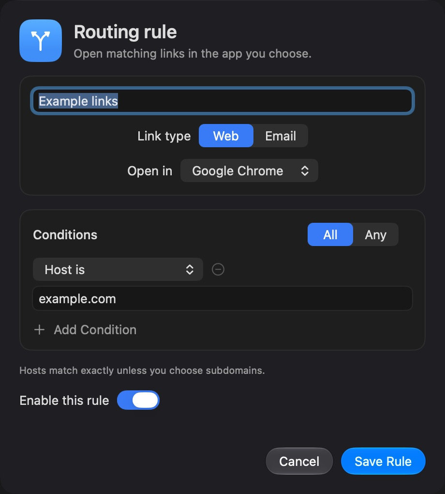
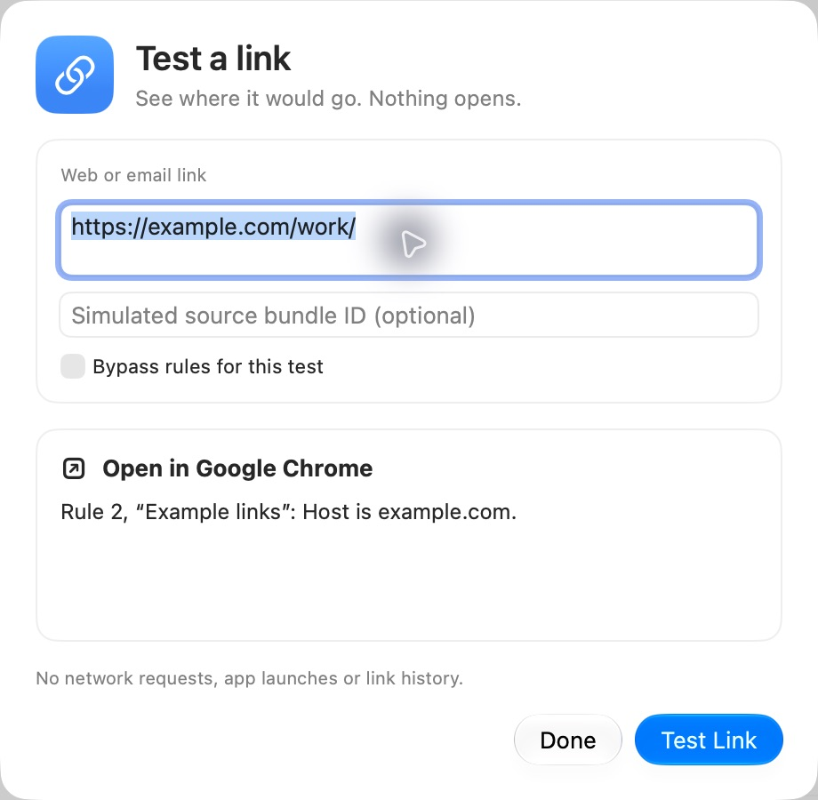
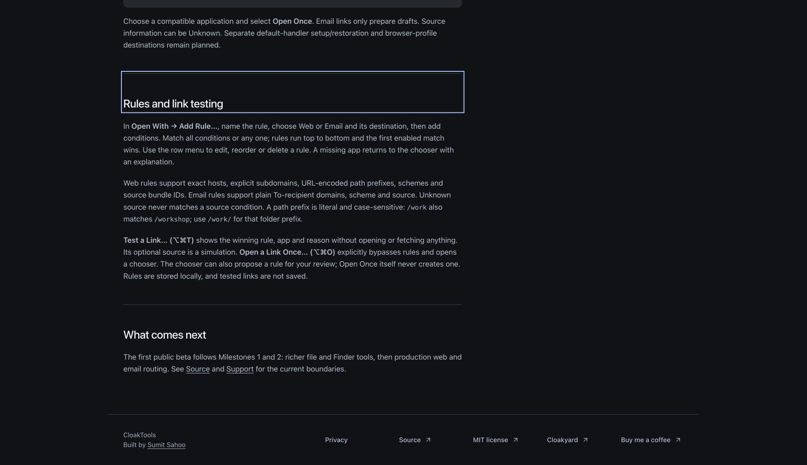

# Open With rules and testing — 0.2.0 (7)

Verified 15 November 2026 on Apple silicon, macOS 27.2.1, Xcode 27.2 / macOS 27.2 SDK. This slice adds local ordered routing rules, automatic app dispatch, a link tester and an explicit one-time bypass. It continues the completed MVP 0 integration paths; it does not complete Milestone 2 or the first public beta.

## Working behavior

- Add, edit, enable/disable, reorder and explicitly delete up to 64 rules. Web/email roles, installed compatible destination picker, All/Any, and 1–8 validated conditions per rule.
- Exact host, optional dot-boundary subdomains, literal encoded path prefix, scheme, source bundle ID and plain To-recipient domain conditions. [Matching semantics and limitations](../OPEN-WITH.md) are explicit.
- First enabled match wins; an unavailable destination does not fall through to a later rule. Unreadable rules, missing destinations, opening failures and immediate bounced links use the chooser with an explanation.
- Real incoming events snapshot rules before queueing and rediscover compatible destinations when processed. Automatic dispatch uses NSWorkspace to the selected non-self app. The five-second loop guard is checked again when queued links begin.
- **Test a Link… (⌥⌘T)** uses the same pure evaluator and supplies current app availability. It displays rule, destination and reason without opening or fetching. Source input is labeled as simulated. Inputs are not persisted.
- **Open a Link Once… (⌥⌘O)** supplies an explicit one-time rule bypass and opens the chooser. **Create Rule…** in the chooser proposes a reviewable rule; saving it affects subsequent URL events and does not open the pending link automatically.
- Rules are versioned, bounded and atomically saved in `routing-rules.json` beside preferences. Production URL history is not written. Last-route feedback contains only rule/app names in session memory.

## Native observations

1. Added an exact `example.com` → Google Chrome rule through the native editor. Test a Link showed its name, priority, destination and matching condition. `example.com.attacker.test` correctly showed the chooser fallback. The explicit bypass test showed the override reason.
2. **Send a Web Link to CloakTools** delivered a genuine URL event and automatically opened Chrome. The actual browser tab showed `https://example.com/?from=cloaktools`; CloakTools showed the rule/app feedback. The verification tab was closed.
3. Open a Link Once with an otherwise matching URL opened the chooser with a bypass explanation. Selected Safari and used Create Rule; the proposed rule contained only `example.com`, with no query. Saved a second rule, then cancelled the pending chooser without opening it.
4. Moved the second rule first. The tester changed to Safari/Rule 1. Quit and relaunched CloakTools; the order persisted. Disabled that rule; the tester selected Chrome/Rule 2. Edited the rule into an email draft: the destination picker showed Mail and the condition changed to To recipient domain. Blank-condition Save displayed validation and did not save. Cancel preserved the original rule.
5. Built the separate native synthetic receiver from `scripts/build-routing-probe.sh`. Replaced only this session’s temporary verification rules with receiver rules, retaining a backup. Actual HTTP and mailto events reached the receiver with exact query, fragment, cc, encoded subject, CRLF body, plus and ampersand strings. After terminating the prior test receiver, `rules-cold-proof` launched the rebuilt receiver cold; later events exercised the running process. [Received synthetic events](routing-rule-events.json) record equality evidence. No mail account or mail send was involved.
6. The receiver explicitly returned `/cloaktools-loop-proof?synthetic=rules2` to CloakTools. The chooser displayed **Automatic reopening was stopped**. The receiver recorded that URL exactly once. No repeated automatic dispatch occurred.
7. A controlled unavailable-destination fixture returned to the chooser and named the matching rule and missing app. A controlled malformed rules file returned to the chooser with a read-error explanation. Restored the backed-up rules and used Refresh Status; the error cleared. These checks used only rules created for this verification, not user rules.
8. Inspected compact native dialogs in dark and light appearances. Fixed a wrapped Match label in the editor and kept validation above the fixed action footer. Return tested/saved as appropriate; Escape cancelled test/editor/chooser windows. Native row menus, switches and deletion confirmation worked.
9. Deleted both temporary example rules through the native UI. Stopped/unregistered the receiver and moved its bundle to `/tmp/CloakTools-RoutingRulesProbe-20261115.app.disabled`. No helper ships inside CloakTools. The final app runs with normal system appearance in Open With, no test rules, existing file preferences retained, and unchanged Chrome web / Mail email defaults. No public site/repository/installer was published.

The initial rule sheet and tester dimensions are **460 × 510 pt** and **460 × 450 pt**. The chooser is **448 × 480 pt**, with a scrollable app list and accessibility-aware Glass footer. The debug appearance override applies only to the app and was removed at handoff; system appearance was not changed.

[Dark tester](../../assets/screenshots/link-tester-dark.png) · [Routing settings](../../assets/screenshots/routing-settings-light.png) · [Real loop warning](../../assets/screenshots/routing-loop-dark.png)

## Automated checks

| Command | Result |
| --- | --- |
| `GIT_CONFIG_COUNT=0 swift test --package-path apps/macos/Packages/CloakToolsCore` | **56 tests passed** |
| `GIT_CONFIG_COUNT=0 ./scripts/build-native.sh` | Host and embedded extension built, Debug arm64, **0.2.0 (7)** |
| `npm --prefix apps/site run verify` | Astro checks/build and 7-page links/assets/metadata/landmarks/pinned-Air validation passed |

Nine new core tests cover host boundaries/spoofing/IDNA/trailing dots, encoded paths, All/Any and source/role semantics, visible priority/disabled rules/missing apps/bypass, bounded mail recipient parsing, original URL preservation, invalid conditions/self destinations, bounded versioned storage/corruption and immutable snapshots. Earlier 47 tests continue to pass. No Swift compiler warnings; only the expected unused AppIntents metadata warning and ad-hoc signing notes. The malformed PDF fixture still emits its expected native parsing diagnostic.

Logs: [core](routing-rules-core.txt), [native build summary](routing-rules-build.txt), [website](routing-rules-site.txt).

The updated Home, Install, Support, Source and Privacy content retains the Cloakyard Air shell and existing unique animation. Browser review inspected the desktop rules guide and 320 px Install/Support pages; document width matched viewport width with no horizontal overflow. Support rule guidance was visually checked at 320 px. Temporary viewport overrides were reset, the verification tab closed and the owned dev server stopped.

## Remaining gates

- Configurable Finder folders are unimplemented. The [access/context matrix](../FINDER-ACCESS.md) documents coverage and the valid app-group signing requirement. This machine reported zero valid signing identities; no borrowed Team ID, unprovisioned entitlement or broad sandbox exception was added.
- Independent explicit default-handler setup/restoration is the next Milestone 2 task. Reading actual defaults does not change them. No system default switch was tested in this slice.
- Real source identity remains Unknown for ordinary URL events. The tester’s simulation does not establish a source integration. Edge was not installed; Edge application routing and profile cold/running behavior remain unverified. Compatible app selection is implemented; broader destination management and configurable fallback policies remain future work.
- macOS 27.0 specifically, full VoiceOver/system accessibility settings, localized long labels, complete installer/Finder lifecycle, maximum-size memory/performance and filesystem/cloud-provider coverage remain release checks. Current UI observations are not a full accessibility audit.
- No network prefetch or app opening exists in the tester’s code path. It consults Launch Services for installed-app availability; no packet-capture audit was performed.
